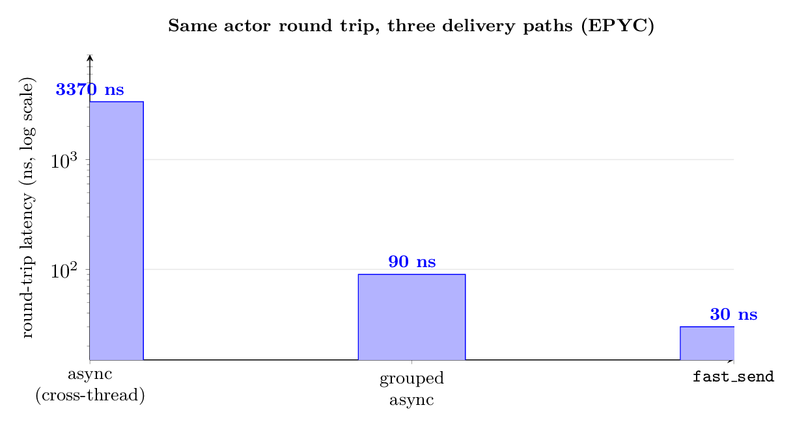

<p align="center">
  <h1 align="center">Kaspar</h1>
  <p align="center">
    <strong>Production Trading System and Position-Aware Order Book Simulator</strong>
  </p>
  <p align="center">
    Venue-independent &bull; CME MDP3 and iLink 3 included &bull; TT FIX order routing &bull; Live crypto simulation (Binance, Coinbase, Hyperliquid) &bull; PCAP Replay &bull; POV Execution &bull; C++20 &bull; FPGA actors (upcoming) &bull; Any venue, generated from its spec (upcoming)
  </p>
</p>

---

<p align="center">
  <a href="https://arxiv.org/abs/2609.21173">Actor Framework for HFT&nbsp;paper&nbsp;(arXiv)</a> &bull;
  <a href="https://arxiv.org/abs/2609.18019">Shadow-POV&nbsp;paper&nbsp;(arXiv)</a> &bull;
  <a href="tech_reports/fpga_actors.pdf">FPGA&nbsp;actors&nbsp;paper&nbsp;(draft)</a> &bull;
  <a href="tech_reports/kaspar_onepager.pdf">one-pager</a>
</p>

**Kaspar-hft** takes a strategy through three stages on one code path: simulation from packet captures, paper trading on live market data, and live execution. It is a production trading system *and* a queue-position-accurate order-book simulator, built on a C++20 actor framework. It is not tied to one market: the feed handler and the order-entry session are pluggable, and it ships with CME's MDP3 market data and iLink 3 order entry pre-built and CME-certified, plus order routing through Trading Technologies (TT) over FIX 4.4, TT-certified. Equities or other venues need their own handlers for those two pieces; the book, simulator, actor framework and strategy code are the same.

## Kaspar-hft highlights

- **Low-latency actor framework:** No data races, no locks in your code, and almost no framework overhead.
- **FPGA actors (upcoming):** The actor framework extended to FPGAs: actors on the card and actors on the CPU exchange the same messages. The first application, a CME MDP3 handler for the AMD Alveo X3522PV, decodes packets as they arrive and sends events to the CPU's books; it meets timing at 250 MHz on the card's FPGA, one step per clock ([mdp3_fpga/](mdp3_fpga/), the [paper draft (PDF)](tech_reports/fpga_actors.pdf), and [below](#upcoming-fpga-actors)).
- **Any venue, generated from its spec (upcoming):** A Claude Code skill turns a venue's public specification into its market-data handler, order manager and post-trade client, as Kaspar actors, tested against the spec's own examples, public sample data, live exchange books and fault injection. 19 venues built so far across US, European and Asian equities, FX, US Treasuries and crypto: Nasdaq, NYSE, Cboe U.S. and Europe, IEX, Deutsche Börse T7, HKEX, Japannext, Aquis, LMAX, EBS, Currenex, Coinbase, Bybit, OKX, Kraken, Deribit, Clear Street and Lime. Decoders match the exchanges' own answer keys field for field; order books agree with recorded data and live snapshots. Every venue that publishes its protocol is now a build away; certification follows venue by venue (branch [`global_connectivity`](https://github.com/vincent212/kaspar-hft/tree/global_connectivity), and [below](#upcoming-any-venue-generated-from-its-spec)).
- **Backtest == production:** The same strategy, execution algorithm, and order book run in PCAP replay, paper trading, and live trading through iLink 3 or TT FIX; switching is a config change, so a backtest exercises the exact code path that will trade.
- **Live crypto simulator:** The same book, shadow lights and simulated order manager on live Binance (spot and USD-M futures), Coinbase (spot) and Hyperliquid (perpetuals) market data, no API key needed. Price-level feeds are split into queues of synthetic orders so fills still go by queue position; orders, BBO and fills are available from Python over zmq ([sim/BINANCE.md](sim/BINANCE.md), [sim/CRYPTO.md](sim/CRYPTO.md)).
- **Venue-independent, CME included:** Feed handler and order-entry session are pluggable. The included MDP3 market-data handler and iLink 3 order-entry session have passed CME autocertification and implement the full session lifecycle.
- **Trading Technologies FIX order routing, TT-certified:** In addition to iLink 3, orders can go out through TT over FIX 4.4, using QuickFIX, as an optional build ([ttom/README.md](ttom/README.md)).
- **Shadow execution algorithm:** A model-free percentage-of-volume execution algorithm, passive and aggressive, measured on a year of ES data.
- **Strategy authoring in C++ or Rust:** Write strategies as in-process actors in C++ (lowest latency), or in Rust via the in-process C++/Rust FFI interop.
- **Two papers to dive deeper, more in the works:** The C++ actor framework design [arXiv:2609.21173](https://arxiv.org/abs/2609.21173) and execution algorithm results [arXiv:2609.18019](https://arxiv.org/abs/2609.18019).
- **Formal semantics for fast_send:** `fast_send` added to the actor model as a second primitive, with an operational semantics and proofs of what it keeps (isolation, determinism relative to replies) and what it costs (liveness holds unless actors wait on each other in a circle) — [paper draft (PDF)](tech_reports/extended_actor_model/extended_actor_model.pdf).
- **Async and sync (`fast_send`) delivery are interchangeable:** A handler is the same code either way, so the mapping of actors to threads can be decided at deployment and tuned for tail latency ([arXiv:2609.32848](https://arxiv.org/abs/2609.32848)).

---

**Kaspar** is two things sharing one codebase.

It is a **production trading system**: market data in, full order books reconstructed order-by-order, an execution algorithm on top, and order-entry sessions out. The feed handler and the order-entry session are the venue-specific pieces; the included CME pair (MDP3 multicast in, iLink 3 out — SBE encoding, HMAC authentication, sequence management and primary/secondary failover) is CME-certified. Orders can also go out through Trading Technologies over FIX 4.4 (TT-certified) in addition to iLink 3. Another venue plugs in its own handler and session.

It is also a **position-aware order book simulator**: order books rebuilt from packet capture files, with your orders placed in the price-time queue and filled only when the market actually trades through them. Fills are inferred from exact queue accounting.

The same strategy code, the same execution algorithm and the same book run in PCAP replay, in live paper trading, and against the live exchange; moving between them is a configuration change. A backtest exercises the code path that will trade. It is built on a custom C++ actor framework with nanosecond-scale messaging.

**Why actors?** Each actor owns its private state and communicates only by messages, so no mutable state is shared between actors: no memory-level data races, no torn reads or writes, and no locks in your own code. You reason about one message at a time against consistent state. The one remaining way to deadlock is a cycle of synchronous `fast_send` calls. Actor code is also unusually easy for AI coding agents to write: the model is simple, the framework's documentation is written for them, and an actor comes with a natural self-contained unit test — send a message in, assert on the reply. The usual objection to the actor model is the messaging overhead; Kaspar answers it with `fast_send`, which runs the receiver's handler inline on the caller's thread and returns the reply as a value (**about 7.5 ns of overhead over a direct call**).

Named after [Kasprowy Wierch](https://en.wikipedia.org/wiki/Kasprowy_Wierch) — *"a peak of a long crest in the Western Tatras, one of Poland's main winter ski areas."*

**Contact Vincent Mayeski:** 
[LinkedIn](https://www.linkedin.com/in/vmayeski/) — [Email](mailto:mayeski@gmail.com) - [Substack](https://vincentmayeski.substack.com/)

## Production-grade session handling — CME- and TT-certified

Kaspar's market-data and order-entry stacks are complete session implementations. The MDP3 market-data handler and the iLink 3 order-entry session have both passed **CME autocertification**; the TT FIX 4.4 order router is **TT-certified**. They implement the full protocol lifecycle and its edge cases — the recovery, reconnection, and failover logic a commercial SDK is sold to cover — so you don't hand-roll any of it.

## Upcoming: FPGA actors

The actor framework has an FPGA side, `kfpga` ([actors/fpga/](actors/fpga/)): actors written in C++ and compiled to hardware with Vitis HLS, one `hls::task` each, exchanging the same messages as the CPU actors across PCIe. The design is described in the paper draft *Adapting the Actor Model of Concurrency to Hybrid CPU/FPGA Architectures* ([tech_reports/fpga_actors.pdf](tech_reports/fpga_actors.pdf)).

The first application is a CME MDP3 handler for the AMD Alveo X3522PV ([mdp3_fpga/](mdp3_fpga/)). On the card, FeedRx, Igmp, SbeDecoder, Filter and Batcher receive the UDP frames, join the multicast group, decode SBE as the bytes arrive, keep the securities the CPU asked for and pack the events into 64-byte lines; on the CPU, the FpgaFeed actor builds the books. It is built and tested in simulation against CME's codec on recorded data, and placed and routed on the card's XCUX35 at 250 MHz, using about 0.6% of the chip. The Ethernet MAC and the PCIe DMA to the host are next ([mdp3_fpga/MDP3_PLAN.md](mdp3_fpga/MDP3_PLAN.md)).

The series on Substack:

1. [From C++ Actors to FPGA Circuits](https://vincentmayeski.substack.com/p/from-c-actors-to-fpga-circuits)
2. [CPU Actors and FPGA Actors: Talking Across PCIe](https://vincentmayeski.substack.com/p/cpu-actors-and-fpga-actors-talking)
3. [Removing latency tails in market data handlers using FPGAs](https://vincentmayeski.substack.com/p/removing-latency-tails-in-market)

## Upcoming: any venue, generated from its spec

Venue connectivity is the cost that has kept trading systems tied to a handful of markets. Kaspar removes it. The `build-feed-handler` skill takes a venue's public specification and produces the three pieces a venue needs: Claude Code writes a cited description of the feed, transcribes the message layouts into field tables that a compiler checks and turns into decoders (or uses the venue's SBE schema or FIX dictionary), builds the market-data handler, order manager and post-trade client as actors on Kaspar's framework, and tests them. Every handler targets the same order books, order router and trade ledger, so each one is verified by feeding its output into Kaspar's own book and comparing, and every gap a venue exposes becomes part of the skill for the next one.

The first run covered 19 venues: US, European and Asian equities, FX, US Treasuries and crypto. The generated decoders matched the exchanges' answer keys field for field, the market-data handlers' books agreed with recorded data and with live exchange snapshots, and the order managers covered the test scenarios of implementations already in production. The handlers are on the [`global_connectivity`](https://github.com/vincent212/kaspar-hft/tree/global_connectivity) branch under `global_connectivity/non_certified/`, one directory per venue with its own README and tests; each moves to `certified/` after a full day of real data, recovery exercised against the venue and an unattended live session.

Next: Euronext, London Stock Exchange, SIX, Nasdaq Nordic, JPX, Korea Exchange, SGX, ASX, NSE, Shanghai, Shenzhen, B3, TSX, ICE, Tradeweb, Interactive Brokers, and any other venue that publishes its protocol. Kaspar's reach is set by the venues' documentation, not by a connectivity backlog.

Article: [Global connectivity for Kaspar-HFT: agent-generated gateways to any venue](https://vincentmayeski.substack.com/) on Substack.

## Build

**Quick start** with `./build.sh`:

```bash
./build.sh schema        # generate the CME SBE codecs (latest CME templates)
./build.sh               # libraries (== make all)
./build.sh -C kaspr/src  # the kaspr binary
./build.sh debug         # debug build
./build.sh -C actors/cpp # build just one component
```

## Tests

```bash
make test                 # unit tests
make test USE_TTOM=y      # also the TT FIX order router tests (needs QuickFIX)
```

The tests use Google Test; if it is not found, point `GTEST_PATH` at it (`mk_kaspr/detect_paths.sh --check` reports what it finds).

## Run a simulation from scratch

Replay a recorded week of CME data and run the shadow algorithm on it (described
in *Model-Free Passive Execution via Order-Level Shadowing*,
[arXiv:2609.18019](https://arxiv.org/abs/2609.18019)). The full walkthrough, with
every option and how to read the output, is in [sim/README.md](sim/README.md).

```bash
# 1. Build the libraries, the simulator and the universe extractor
./build.sh schema && ./build.sh
./build.sh -C sim/src
./build.sh -C dbento_pcap_parse/build_universe/src

# 2. Download a recording (SFTP, user data, password data, read-only)
mkdir -p ~/recdata/344 && cd ~/recdata/344
sftp data@m2te.ch            # then: get 344.20261018.1792363121000041934.22.38.1.bin

# 3. Extract the instruments from it
~/kaspar-hft/dbento_pcap_parse/build_universe/src/build_universe 344.20261018.1792363121000041934.22.38.1.bin

# 4. Run the week (ZN, tuned config) in its own directory
mkdir -p runs/week1 && cd runs/week1
gunzip -c ../../universe.344.20261018.1792363121000041934.json.gz > universe.json
~/kaspar-hft/sim/src/sim --datafile ../../344.20261018.1792363121000041934.22.38.1.bin \
    --universe universe.json --contract ZNZ6 --config ~/kaspar-hft/sim/config_zn \
    --probe-size 100 --probe-date 20261019-20261023 --probe-end 1200 \
    --probe-out probe.csv --quiet > out.txt 2> err.txt

# 5. Slippage and participation per day
~/kaspar-hft/sim/scripts/slippage_report.py probe.csv
```

A week takes about 7 minutes with `config_zn`. It passes if it exits 0, `out.txt` ends
with `=== sim complete ===`, and the `TOT PNL` line shows `ORD` and `FIL` above 0.

## Operating Modes

| Mode | Market data | Orders go to | Use |
|------|-------------|--------------|-----|
| **PCAP Replay** | Recorded CME packets | Simulated fills | Backtesting, strategy development |
| **Paper Trading** | Live CME multicast | Simulated fills | Forward testing with real data |
| **Paper Trading, crypto** | Live Binance, Coinbase or Hyperliquid WebSocket | Simulated fills | Forward testing on crypto (`bnsim`) |
| **Live, CME direct** | Live CME multicast | CME iLink 3 | Production execution |
| **Live, via TT** | Live CME multicast | TT FIX 4.4 | Production execution through a TT account |


## Actor Framework

The actor framework provides a uniform concurrency model for the entire system. Coding agents will pick up the documentation and will write actor components for you. All you have to do is fill in
your message handlers.

- **Message passing** — a mailbox per actor (`BQueue` by default; see below)
- **Groups** — A `Group` runs multiple actors on a single thread with a single message queue. Enables deterministic simulation.
- **Zero-copy fast path** — `fast_send()` executes the handler in the caller's thread for synchronous queries — no queue, no thread hop, message passed on the stack.
- **C++/Rust interop** — Strategies can be coded in C++ or Rust.

The design behind the framework is written up in the articles listed under
[Deep Dives](#deep-dives).

```cpp
class MyStrategy : public Actor {
public:
    MyStrategy(actor_ptr ob, actor_ptr som) : Actor("strategy") {
        MESSAGE_HANDLER(frame::ob::msg::EndOfBurst, on_book_update);
        MESSAGE_HANDLER(frame::som::msg::Fill, on_fill);
        this->ob = ob;
        this->som = som;
    }

private:
    void on_book_update(const frame::ob::msg::EndOfBurst* eob) {
        // React to order book changes
        auto* order = new frame::som::msg::Order(
            "ESM6", en::BuySell::BUY, 1, eob->best_bid, en::x::CMEMDFUT);
        som->send(order, this);
    }

    void on_fill(const frame::som::msg::Fill* fill) {
        // Handle execution
    }
};
```

The same strategy actor in the Rust port ([`actors/rust`](actors/rust)) — handlers are plain methods,
wired up by the `handle_messages!` macro; message ids are compile-time constants:

```rust
struct MyStrategy {
    ob: ActorRef,
    som: ActorRef,
}

impl MyStrategy {
    fn on_book_update(&mut self, eob: &EndOfBurst, ctx: &mut ActorContext) {
        // React to order book changes
        self.som.send(
            Box::new(Order::new("ESM6", Side::Buy, 1, eob.best_bid, Venue::CmeMdFut)),
            ctx.self_ref(),
        );
    }

    fn on_fill(&mut self, _fill: &Fill, _ctx: &mut ActorContext) {
        // Handle execution
    }
}

handle_messages!(MyStrategy,
    EndOfBurst => on_book_update,
    Fill       => on_fill,
);
```

## Choosing the Right Queue for Your Actor

Every actor has a **mailbox**: a multi-producer/single-consumer (MPSC) queue that
other threads push messages into and the actor's own thread drains.

Pick the best queue for your use case:

- **BQueue** — mutex + condition variable around a ring buffer. Simple, FIFO,
  sleeps when idle. **This is the default** (no `set_mailbox` call needed).
- **BQueueBatched** — same, but the consumer drains the whole mailbox under one
  lock instead of locking per message.
- **ShardedBQueue** — the mailbox split into N independent lanes, each with its
  own lock; producers round-robin across lanes to avoid contending on one lock.
  It does **not** preserve FIFO across lanes, so use it only for actors whose
  handlers are order-independent (an aggregator / order book), never where a
  Start-before-Data or sequence-number ordering is assumed.
- **LockFreeMPSC** — a bounded lock-free ring; producers claim a slot with a
  single atomic operation. Park-free while space is available; if the ring
  fills, a producer spins briefly then blocks (so size the ring for peak
  backlog).
- **LockFreeMPSCSpin** — the same ring with a consumer that never sleeps: the
  actor's thread busy-polls its mailbox. The lowest hand-off latency between
  threads, at the cost of a whole core per actor; only worth it on isolated cores.

More on choosing: [**Not All Queues Fit All in Low-Latency Systems**](https://vincentmayeski.substack.com/p/not-all-queues-fit-all-in-low-latency).

## Monitoring

A running `kaspr` process exposes a **ZMQ request/reply control console** (the
`mq0` server) for live monitoring and manual intervention — inspect books and
positions, place/cancel orders by hand, and pause/resume the order matcher, all
without restarting.

### Connecting

```python
import zmq

ctx = zmq.Context()
sock = ctx.socket(zmq.REQ)
sock.setsockopt(zmq.RCVTIMEO, 10000)
sock.setsockopt(zmq.SNDTIMEO, 10000)
sock.setsockopt(zmq.LINGER, 0)
sock.connect("tcp://localhost:7777")

sock.send_string("bbbo")
print(sock.recv_string())        # prints an ASCII table
```

## Configuration

```ini
kaspr {
    general {
        universe config/universe.csv
        mqport 7777
        tachbook false           # true + USE_TACHBOOK=1 for live
    }
    channels {
        chan_310 true             # ES futures
        chan_318 true             # NQ futures
    }
}
```

## Documentation

| Document | Description |
|----------|-------------|
| [STRATEGY_SIMULATOR_GUIDE.md](STRATEGY_SIMULATOR_GUIDE.md) | Complete guide to the operating modes |
| [sim/README.md](sim/README.md) | Running a simulation from a recording, and reading the output |
| [sim/BINANCE.md](sim/BINANCE.md) | `bnsim`: the simulator on live Binance data |
| [sim/CRYPTO.md](sim/CRYPTO.md) | `bnsim` on live Coinbase and Hyperliquid data |
| [ttom/README.md](ttom/README.md) | TT FIX 4.4 order router: build, configuration, tests |
| [kaspr/perf/README.md](kaspr/perf/README.md) | Measuring market-data latency end to end |
| [SHADOW_ALGORITHM.md](light/SHADOW_ALGORITHM.md) | Shadow execution algorithm specification |
| [ACTORS_INVENTORY.md](ACTORS_INVENTORY.md) | Every actor in the system |
| [FILE_STRUCTURE.md](FILE_STRUCTURE.md) | Complete file and directory inventory |
| [CLAUDE_AGENT_GUIDE.md](actors/cpp/CLAUDE_AGENT_GUIDE.md) | Actor framework technical reference |
| [actors/rust/README.md](actors/rust/README.md) | Rust actor-framework port — overview & quickstart |
| [actors/rust/DEVELOPER_GUIDE.md](actors/rust/DEVELOPER_GUIDE.md) | Writing actors in the Rust port |
| [actors/fpga/README.md](actors/fpga/README.md) | FPGA actors (upcoming): actors on the card and CPU actors talking to them with the same `send`; examples and how to run them |
| [actors/fpga/HLS.md](actors/fpga/HLS.md) | How FPGA actors become circuits in Vitis HLS, and how to check a design with AMD's tools |
| [mdp3_fpga/README.md](mdp3_fpga/README.md) | The MDP3 handler on the Alveo X3522PV: what it does, how it is checked, results so far |
| [mdp3_fpga/DESIGN.md](mdp3_fpga/DESIGN.md) | The MDP3 handler on the card: actors, message and event formats, synthesis results |
| [mdp3_fpga/MDP3_PLAN.md](mdp3_fpga/MDP3_PLAN.md) | Plan and status of the MDP3 handler on the card, and what is still to build |
| [docs/ILINK_FPGA_PLAN.md](docs/ILINK_FPGA_PLAN.md) | Plan: iLink 3 order entry on the card |
| [tech_reports/fast_send.pdf](tech_reports/fast_send.pdf) &middot; [arXiv:2609.21173](https://arxiv.org/abs/2609.21173) | Technical report: `fast_send` synchronous message delivery |
| [tech_reports/shadow_pov.pdf](tech_reports/shadow_pov.pdf) &middot; [arXiv:2609.18019](https://arxiv.org/abs/2609.18019) | Technical report: Shadow-POV passive execution |
| [tech_reports/fpga_actors.pdf](tech_reports/fpga_actors.pdf) | Paper draft: adapting the actor model to hybrid CPU/FPGA architectures |

## Performance Characteristics

- **Actor async send**: fast enqueue (mutex + condition variable, no allocation on hot path)
- **Actor sync send**: on the stack, on the caller's thread, bypassing the queue (it never interrupts a handler that is running)
- **Memory**: Pool allocators for same-size messages
- **Grouping**: One thread per actor group

### Measured: actor messaging round-trip latency

<p align="center">
  <picture>
    <source media="(prefers-color-scheme: dark)" srcset="tech_reports/img/fast_send_latency_dark.png">
    
  </picture>
</p>

**How much does the actor machinery cost over a bare function call?** Timed
cleanly (one clock-read pair around a tight loop, identical trivial work on a
stack input), on the same AMD EPYC 9374F: a direct, non-inlined call takes
1.6 ns and a `fast_send` dispatch 9.1 ns, so the actor machinery adds **about
7.5 ns** per hop. A full `fast_send` round trip with a reply is about 30 ns (the
chart above). Details: [perf README](actors/cpp/perf/README.md#d-fast_send-vs-a-bare-function-call).

## Market-data latency (live CME MDP3)

Socket-to-book latency measured on live CME futures (ES, NQ and ZN) on
2026-10-02: two 5-minute runs, the first 60 s of each dropped, Onload, one feed
(feed B switched off), threads not pinned. The socket reader thread decodes each
packet and updates the book itself, with no thread hand-off. Measured per message
from the socket read (`t0`) to the book publish (`t1`); time in the NIC and socket
buffer is not included. All figures in µs.

| stream | messages | p1 | p10 | p50 | p90 | p99 | p99.9 |
|---|---:|---:|---:|---:|---:|---:|---:|
| ES book | 401,462 | 0.5 | 0.7 | 1.1 | 2.7 | 9.9 | 24.1 |
| NQ book | 581,010 | 0.4 | 0.5 | 0.8 | 1.9 | 4.7 | 8.8 |
| ZN book | 141,972 | 0.4 | 0.6 | 1.0 | 2.5 | 20.6 | 69.3 |
| ES trade | 45,733 | 0.5 | 0.7 | 2.5 | 8.8 | 36.2 | 70.1 |
| NQ trade | 21,093 | 0.4 | 0.6 | 0.9 | 3.3 | 17.8 | 31.5 |
| ZN trade | 13,282 | 0.4 | 0.7 | 6.6 | 41.5 | 90.5 | 124.0 |

The upcoming FPGA MDP3 adapter ([mdp3_fpga/](mdp3_fpga/)) should take about 1.5 µs
from the wire to the order book, with no tail: the card decodes each packet as its
bytes arrive, so long packets do not queue behind each other. That figure starts at
the wire, not at the socket read as above, and is an estimate until the card's
Ethernet MAC and PCIe DMA are built.

## Shadow Execution Algo

Most execution algorithms either cross the spread (expensive) or continuously quote (noisy, adverse selection). Kaspar takes a third path: **shadow execution** — a percentage-of-volume algorithm that participates in natural market flow by following the orders other participants place.

For more detail — *Model-Free Passive Execution via Order-Level Shadowing* — on arXiv: [**arXiv:2609.18019**](https://arxiv.org/abs/2609.18019).

## Deep Dives

Deep-dives on the design behind Kaspar (author's Substack — [vincentmayeski.substack.com](https://vincentmayeski.substack.com)):

- [**Removing latency tails in market data handlers using FPGAs**](https://vincentmayeski.substack.com/p/removing-latency-tails-in-market) — the CME MDP3 handler on the AMD Alveo X3522PV: a CPU handles a packet only after all of it has arrived, so long packets back to back queue; actors on the card decode as the bytes arrive ([mdp3_fpga/](mdp3_fpga/)).
- [**CPU Actors and FPGA Actors: Talking Across PCIe**](https://vincentmayeski.substack.com/p/cpu-actors-and-fpga-actors-talking) — messages between CPU and FPGA actors in 64-byte slots: the CPU writes into windows on the card, the card DMA-writes into rings in host memory, and the reader checks the sequence number last to know a message is complete ([actors/fpga/](actors/fpga/)).
- [**From C++ Actors to FPGA Circuits**](https://vincentmayeski.substack.com/p/from-c-actors-to-fpga-circuits) — how the actor model, `send` and `fast_send`, maps onto an FPGA: Vitis HLS turns C++ into circuits, and an actor, or a group of actors, becomes a hardware process, with FIFOs between them.
- [**Low-Latency Actor Systems in C++ and Rust**](https://vincentmayeski.substack.com/p/low-latency-actor-systems-in-c-and) — building the same actor framework in both languages: this repo's C++ core and its Rust port (`actors/rust`), and what carries over vs. what the borrow checker changes.
- [**Actors in C++ and Rust: The Benchmarks, and the Bridge Between Them**](https://vincentmayeski.substack.com/p/actors-in-c-and-rust-the-benchmarks) — the two ports benchmarked head to head (`fast_send`, `send`, allocation), and the in-process C++/Rust interop bridge, with numbers.
- [**Lock-Free Isn't Free: Cache Pollution, Busy Cores, and Why Kaspar Blocks**](https://vincentmayeski.substack.com/p/lock-free-isnt-free-cache-pollution) — why lock-free can be the slower choice under load (spinning consumers, cache coherence, oversubscription), and why the `BQueue` blocks and `fast_send` minimizes thread hops instead.
- [**If a Machine Is Going to Write the Code, Make It Rust**](https://vincentmayeski.substack.com/p/if-a-ai-is-going-to-write-the-code) — why Rust is the best language for AI-generated code (compiled, plus the strictest mainstream compiler at catching bugs up front), and why Kaspar added C++/Rust interop.
- [**The Actor Model for Low-Latency Software**](https://vincentmayeski.substack.com/p/the-actor-model-for-low-latency-software) — a concurrency model invented for single-CPU machines turned out to be the right one for multicore.
- [**A High-Performance Mailbox in the Kaspar C++ Actor System**](https://vincentmayeski.substack.com/p/high-performance-mailbox-in-the-kaspar) — ring buffers are great until they overflow (the `BQueue` design).
- [**A Custom Memory Allocator for the Kaspar Actor System Gives 10× Improvement**](https://vincentmayeski.substack.com/p/a-custom-memory-allocator-for-the) — when you know the size at compile time, almost everything an allocator does becomes unnecessary (the object pool).
- [**How Message Batching More Than Doubles Actor Model Throughput**](https://vincentmayeski.substack.com/p/how-message-batching-more-than-doubles) — draining the whole mailbox under one lock, plus the message pool, for a 2.46× throughput win (and why batching the *sender* backfires). *The code was on the `sharded-mailbox` branch ([PR #20](https://github.com/vincent212/kaspar-hft/pull/20)), which was closed without merging; batched draining is available as the `BQueueBatched` mailbox.*
- [**Medians Lie, Tails Kill: Why Kaspar Shards Mailbox Locks**](https://vincentmayeski.substack.com/p/medians-lie-tails-kill-why-kaspar) — per-actor mailboxes shard lock contention to flatten tail-latency jitter (~180× at p99.9). *The sharded mailbox is available as `ShardedBQueue`.*
- [**The Lock-Free Illusion: Why CAS Storms Kill Actor Queues Under Contention**](https://vincentmayeski.substack.com/p/the-lock-free-illusion-why-cas-storms) — when a lock-free mailbox wins and when it tails worse than a mutex; the queue-selection matrix. *The lock-free mailbox is available as `LockFreeMPSC`.*
- [**Shadow POV Execution: Trade Where the Market Is Going to Trade**](https://vincentmayeski.substack.com/p/shadow-pov-execution-trade-where) — a percentage-of-volume algorithm that follows passive flow.

## License

MIT License. Copyright (c) 2026 Vincent Mayeski / M2 Tech (16425640 Canada Inc.). See [LICENSE](LICENSE).
