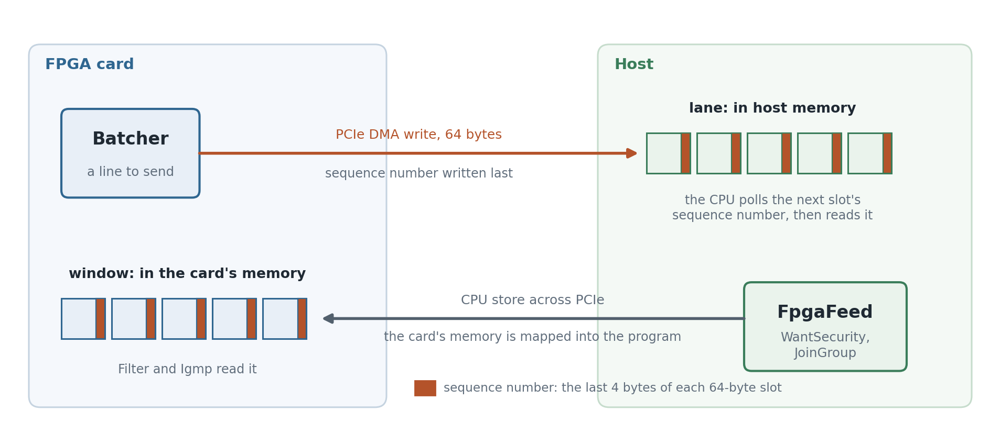
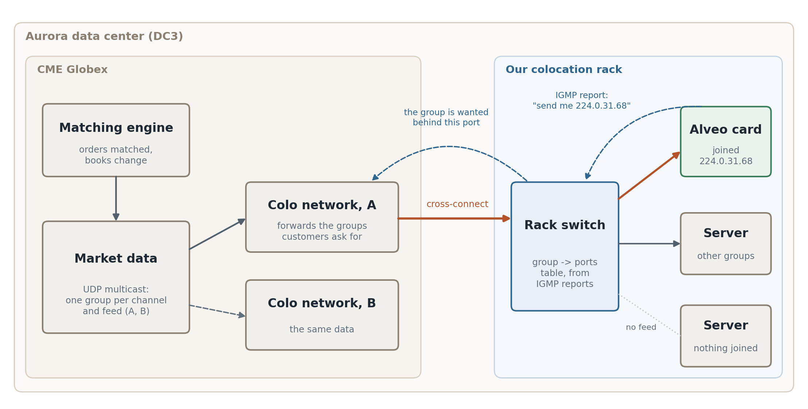
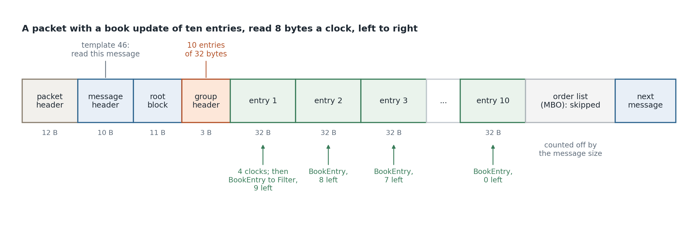
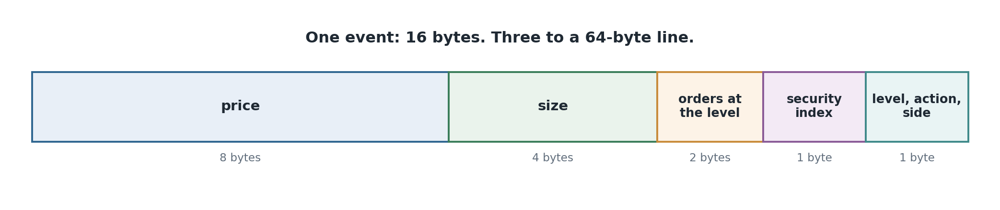

# Removing latency tails in market data handlers using FPGAs

*The MDP3 implementation*

[Kaspar-HFT](https://github.com/vincent212/kaspar-hft) is an open-source 
production system and an order-book simulator on one
code path: the same strategy runs on recorded packets, paper trades on live data, and
trades live, and its MDP3 market data handler and iLink 3 order entry have passed CME's
certification. Everything in it is an actor: an object that owns its state and talks to others only
by messages, in a C++20 framework built for low latency
([arXiv:2609.21173](https://arxiv.org/abs/2609.21173)).

The framework now has FPGA actors too. The same model, actors with handlers that send
messages, runs on an FPGA card, and a C++ actor on the CPU and an actor on the card
exchange messages across PCIe as two actors on the CPU would. Two earlier articles laid
this out. [From C++ actors to FPGA circuits](https://vincentmayeski.substack.com/p/from-c-actors-to-fpga-circuits) showed how an actor becomes
hardware: each actor is a process of its own, a send is a write into a FIFO between two
processes, and actors grouped together share a process. [CPU actors and FPGA actors
talking](https://vincentmayeski.substack.com/p/cpu-actors-and-fpga-actors-talking) showed how the two sides meet across PCIe. That makes it possible to
move part of Kaspar-HFT onto the card without changing how the rest of it is written.
This article is about the first part to move, the market data handler, and why: to
remove its latency tail.

A market data handler turns the exchange's packets into order books the strategy can
trade on. In software it has a latency tail, and the tail comes from the long packets.

The CPU handles a packet as a whole. It can start only once the entire packet is in
memory, and then it decodes it message by message, so the decode takes longer the longer
the packet. A CME packet can carry dozens of book updates. When long packets arrive one
after another, each waits for the decode of the one before, and the handler falls
behind. That is the tail.

The FPGA decodes the packet as it comes in. The decoder, the filter and the packer are
stages of a pipeline, each taking one step per clock, so the first entry of a packet is
decoded, filtered and packed while the rest of the packet is still on the wire. When the
last byte arrives, only a few clocks of work remain, the same for a long packet as for a
short one, and nothing is left over to delay the next packet.

What follows is Kaspar-HFT's MDP3 handler rebuilt that way. The card takes the feed off
the wire and sends the CPU only what the strategy trades, packed into 64-byte lines.
Five actors run on the card and one on the CPU, where the books are built and the
strategy runs as before.

## The usual low-latency design: kernel bypass

On Linux the network stack lives in the kernel: Ethernet, IP, UDP and TCP processing,
the socket buffers, and multicast membership. A received frame raises an interrupt, is
taken through the kernel's protocol code, copied into a socket buffer, and handed to the
application by a system call.

Kernel bypass takes the kernel out of that path, and nothing more. It rests on the way
any modern NIC delivers frames. The NIC and the host share a *receive ring*: a circular
list of descriptors in host memory, each pointing to a buffer. The NIC writes each
received frame by DMA into the next free buffer and marks its descriptor filled. With the
kernel in the path, the kernel's driver empties that ring; with kernel bypass, the
application's own thread does, polling the next descriptor until it fills.

- **OpenOnload**, from AMD Solarflare, the maker of this card, maps the receive ring into
  the application's memory, and a user-space library, preloaded beneath the BSD socket
  API, does the protocol processing the kernel would have done. Onload is a generic,
  shrink-wrapped way of not using the kernel's TCP/IP code. It is the same work, for the
  same protocols, offered to any application unchanged, moved out of the kernel into a
  library so that it runs without system calls or interrupts.
- **ef_vi** is the layer beneath Onload, Solarflare's interface to the NIC's *virtual
  interfaces*. An application opens one and gets its receive ring and buffers directly:
  raw frames, with no sockets and no protocol code. Everything above Ethernet is the
  application's to do.
- **DPDK**, the Data Plane Development Kit, is the vendor-neutral equivalent: an
  open-source set of libraries, begun by Intel, with *poll-mode drivers* for many NICs.
  The driver runs in the application's process, and the application takes raw frames
  from the NIC's receive queues, again doing all the protocol work itself.

None of these changes *where* the work is done. The CPU still polls the receive ring,
parses the Ethernet, IP and UDP headers, decodes every SBE message of every packet,
discards the instruments it does not trade, and maintains the books. All of that costs
in proportion to the bytes received, including the bytes the strategy never uses, and
it is serialized on one core. Kernel bypass removes the operating system's overhead. It
does not remove the protocol and decode work, and so it does not remove the tail.

## This design: the handler split between the FPGA and the CPU

Here the handler is split in two. The FPGA, an AMD Alveo X3522PV whose network port is
wired straight to the chip, takes the frames off the wire and does all the work that
grows with the packet: the Ethernet, IP and UDP headers, the SBE decode, dropping the
instruments the strategy does not trade, and packing what is left into 64-byte lines.
It also subscribes to the multicast group itself. The CPU builds the order books from
those lines and runs the strategy.

Every stage, on the card and on the CPU, is an actor. The card and the CPU talk over
PCIe through two rings of 64-byte slots, one for each direction, the design of
[CPU actors and FPGA actors talking](https://vincentmayeski.substack.com/p/cpu-actors-and-fpga-actors-talking): writes across PCIe are cheap and reads are
slow round trips, so each side only ever writes to the other, and each reader polls its
own memory instead of waiting for an interrupt. 64 bytes is a cache line,
so a message is exactly one line, and the last 4 bytes of each slot are its sequence
number.

- **Card to CPU: the lane.** It sits in host memory. The card writes each line into the
  next slot with a PCIe DMA write, the sequence number last. The CPU watches the sequence
  number of the next slot; when it changes, the slot is complete, and the CPU reads it.
- **CPU to card: the window.** It sits in the card's memory. The card makes that memory
  visible to the host, and the driver maps it into the program, so the CPU writes a slot
  with an ordinary store, which travels to the card as a PCIe write. The window carries
  the start-up messages: which securities to keep, which group to join.

There are no locks and no atomic operations. A 64-byte read is not atomic and does not
need to be: the reader only waits for the 4-byte sequence number, an ordinary aligned
load, and the writer makes sure that number lands last. PCIe delivers writes in order
(with relaxed ordering off for them, which the DMA engine is configured to do),
so the card's DMA engine writes the sequence number as a separate write after the rest
of the slot. Nothing else is on the receive path: no driver, no
socket, no protocol library, no interrupt.

| | Linux kernel stack | Kernel bypass (Onload, ef_vi, DPDK) | This design |
|---|---|---|---|
| Ethernet, IP, UDP | kernel | user-space library or application, on the CPU | FeedRx, on the card, as the bytes arrive |
| SBE decode | application, on the CPU | application, on the CPU | SbeDecoder, on the card |
| instruments not traded | decoded, then discarded, on the CPU | decoded, then discarded, on the CPU | discarded by Filter; never cross PCIe |
| crosses PCIe | every frame | every frame | 64-byte lines of wanted events only |
| CPU work for a packet | interrupt, protocol, copy, system call, decode, books | poll, protocol, decode, books | poll; after the last byte, at most two events |
| multicast join (IGMP) | kernel | kernel (Onload, ef_vi), or the application itself (DPDK) | the Igmp actor, on the card |
| delay after a packet's last byte | grows with the packet and the queue | grows with the packet and the queue | the same for every packet: about 100 ns on the card, then the PCIe transfer |

The difference comes from four properties.

- **Bounded by construction.** Every actor on the card takes one step per clock, in
  lockstep with the wire, so nothing queues. Over all 30,044,560 packets of a CME
  session, the work left after a packet's last byte never grew with the packet (see
  "Long packets" below).
- **The work overlaps the arrival.** By the time a packet's last byte arrives, every
  entry before it has been decoded, filtered and packed, and its full lines are already
  in host memory. A software handler cannot start until the NIC has delivered the
  frame.
- **The host sees only what it trades.** Unwanted instruments are dropped on the card.
  They cost the CPU no cycles and no cache lines.
- **No protocol stack on the host at all.** The receive path is a ring in memory,
  written by the card and polled by one core. There is nothing generic left in it to
  tune or to bypass.

What remains after the last byte is the same for every packet: about 100 ns on the card,
the PCIe transfer (about 300 to 400 ns, an estimate), and at most two events applied on
the CPU. Section "Long packets" below has the numbers.

## The actors

| actor | where | what it does |
|---|---|---|
| FeedRx | card | keeps the frames of our multicast group and strips their headers |
| Igmp | card | asks the switch for the group, and keeps the membership alive |
| SbeDecoder | card | decodes each packet as it arrives, one message per entry |
| Filter | card | keeps the securities the strategy trades, packs each entry into 16 bytes |
| Batcher | card | puts the events into 64-byte lines and closes each packet |
| FpgaFeed | CPU | builds the books from the lines and hands them to the strategy |

**How an actor runs on the card: a task.** The earlier articles said that each actor
becomes a hardware process; they did not say what kind. In high-level synthesis, the
usual way to run several functions at once is a *dataflow region*: a top function calls
them, they work concurrently through one batch of data, and the top returns when all of
them are done. That suits an accelerator, which the host calls with a block of work and
waits for. A market data handler has no batch and no end: the feed never stops.

So each actor here is an `hls::task`. HLS turns the task's function into a circuit that
starts when the card does and repeats for as long as it is powered. Nothing calls it and
it never returns. The function's body is one step of the actor: read at most one input,
run the handler, write what it sent. HLS pipelines that body so a new step starts every
clock, and the actor's state is kept in registers that carry over from one step to the
next. The task is, in hardware, what an actor's thread with its message loop is on the
CPU.

The actors are joined by FIFOs, small hardware queues with one writer and one reader,
and those are their only connection: a message sent is one write into a FIFO. All five
run at the same time, so while Batcher handles one event, Filter handles the next,
SbeDecoder reads the next 8 bytes and FeedRx the next part of a frame.

FeedRx and SbeDecoder take their data as raw 8-byte words rather than messages, since
wrapping each word in a 64-byte message would waste the link; their few control messages,
and everything the other actors take, go to message handlers written the way a
Kaspar-HFT actor on the CPU writes them.

The design takes one step per clock in every actor and was placed and routed on the
card's chip, an AMD XCUX35, at 3.47 ns, about 288 MHz. It runs at 250 MHz, using about
6,000 lookup tables, 14,400 flip-flops and 23 block RAMs, under 1% of the chip.

**Testing it.** The same actor code also compiles as ordinary C++, with each actor's
step called once per simulated clock. That runs a whole recorded session through the
card, clock by clock; the session results in this article come from that model. The
generated hardware was then simulated on the busiest 2,000 consecutive packets of the
session and produced the same output.

## From the fibre to FeedRx: the MAC

The card's network port is wired straight to the FPGA. AMD supplies no ready-made design
around the chip for this card, so everything between the fibre and the first actor is
part of our design. Three layers turn light on a fibre into Ethernet frames.

1. **The transceiver** recovers the clock from the 10.3125 Gbit/s serial signal and turns
   the stream of bits into parallel words.
2. **The PCS** (physical coding sublayer) undoes 10 GbE's line coding. The wire carries
   66-bit blocks, scrambled so the signal keeps changing; the PCS finds where the blocks
   begin, unscrambles them, and decodes each one into data bytes or control symbols that
   mark a frame's start and end and the idle time between frames.
3. **The MAC** (media access control, the Ethernet layer proper) finds each frame,
   strips the preamble that precedes it, and checks the frame check sequence, the CRC-32
   at its end. It hands the frame on, minus the CRC, with a flag on the last word saying
   whether the CRC was good.

All three come from one block in AMD's Vivado IP catalogue, the 10G/25G Ethernet
Subsystem, configured for low latency. It is built into the FPGA alongside the actors:
the transceiver is a hard block of the chip, and the PCS and MAC are ordinary FPGA logic
next to FeedRx. Configured for 64-bit words, it delivers each frame as 8-byte words at
156.25 MHz. Sending
works the same way in reverse: the MAC takes a frame as words, adds the preamble, pads
it to Ethernet's 60-byte minimum, appends the CRC, and the lower layers put it on the
fibre. The only frames this card sends are Igmp's.

Two details join the MAC to the actors.

- **Two clocks.** The MAC's clock follows from the wire. 10 GbE carries 10 Gbit/s of data,
  and the MAC hands it over 64 bits at a time, so it needs 10 Gbit/s / 64 = 156.25 MHz.
  The actors run on a clock of their own, 250 MHz, chosen for them. At 8 bytes a clock
  that is 16 Gbit/s, more than the wire can deliver, so the actors always keep up, and
  each clock is 4 ns instead of 6.4, so every clock of work after a packet's last byte
  costs less. A small asynchronous FIFO carries the words from one clock to the other, in
  each direction, at a cost of a few clocks.
- **A bad frame is known only at its end.** FeedRx and SbeDecoder act on each word as it
  arrives; that is where the low latency comes from. So when the CRC turns out to be bad,
  the frame's entries have already been decoded. The MAC's verdict therefore rides along
  to the End line, and FpgaFeed treats a bad frame like a missing packet: it sets the gap
  flag. On fibre this is rare, but a damaged frame must never change a book silently.

### UDP on the card

To see why the card needs no network stack, follow the data from CME.

CME's matching engine sits in its data center in Aurora, Illinois (DC3), and our server
sits in the same building, in a colocation rack. Every change to a book goes out as
market data: UDP multicast packets, with each channel on its own multicast group, and
each sent twice, as feed A and feed B, over two separate networks so that losing one
loses nothing. A multicast group is an address like 224.0.31.68 that names a stream
rather than a machine; anyone can ask to receive it.

The data reaches our rack through CME's colocation network and a cross-connect, a cable
from CME's network to the switch in our rack. Not everything CME publishes comes down
that cable: CME's network forwards a group to a customer only when someone behind the
customer's port has asked for it, and the switch in the rack does the same for its own
ports. A switch is a box of Ethernet ports that forwards
each frame only to the port it is meant for. For multicast it keeps a table of which
ports want which group, learned by listening to the IGMP reports the hosts send
("send me 224.0.31.68"); this is IGMP snooping. A frame of that group then goes only to
those ports. The card asks for one group, channel 344 feed A, and so receives one
channel's feed and nothing else. A server that has asked for nothing receives nothing.

**What a switch is, inside.** The rack switch is a separate box, usually one rack unit
high at the top of the rack, with a row of network ports on its face; every server in
the rack plugs into it. Inside are two quite different things. The forwarding is done by
a chip built for nothing else, usually an ASIC, sometimes an FPGA in switches made for
trading: it reads each frame's destination and sends it out of the right ports, in
hardware, at full speed on every port at once. Beside it sits a small ordinary CPU that
runs the switch's software: configuration, and the protocols that fill the chip's
tables. IGMP snooping is one of those. The CPU sees the IGMP reports, works out which
port wants which group, and writes the answer into the chip. Market data itself never
touches that CPU.

A router is the same kind of box, a forwarding chip and a control CPU, working one level
up: a switch moves Ethernet frames between the ports of one network, a router moves IP
packets between networks. In colocation we need none of our own. The routing is done in
CME's network, on the far side of the cross-connect, and our rack needs only a switch. A
router of our own would be needed only to carry the feed somewhere else, to another data
center.

How long a frame spends in the switch depends on the kind of switch:

| switch | kind | latency, port to port (vendor figures) |
|---|---|---|
| Arista 7130 Connect | layer 1: copies the signal, reads nothing | 4 ns (6 ns for the 96-port model) |
| Cisco Nexus 3550-F | layer 1 patch | 3 to 5 ns |
| Cisco Nexus 3550-F | layer 2 switching, on an FPGA | from 95 ns |
| Cisco Nexus 3548 | layer 2 and 3, custom ASIC | about 190 ns in its fastest mode, 250 ns otherwise |
| Arista 7150S | layer 2 and 3, ASIC | from 350 ns |

Sources: [Arista 7130 Connect datasheet](https://www.arista.com/assets/data/pdf/Datasheets/7130-Connect-Series-Datasheet.pdf),
[Cisco Nexus 3550-F datasheet](https://www.cisco.com/c/en/us/products/collateral/switches/nexus-3550-series/nexus-3550-f-program-app-platform-ds.html),
[Nexus 3548 at launch](https://www2.computerworld.co.nz/article/436851/cisco_looks_one-up_arista_juniper_nexus_3548/),
[Arista 7150S datasheet](https://www.arista.com/assets/data/pdf/Datasheets/7150S_Datasheet.pdf).

A layer 1 switch is a special case. It does not read frames at all; it copies the
electrical signal from one port to the ports patched to it. It is the fastest box there
is, and it does no IGMP filtering: a port patched to a feed receives everything on that
link. Behind one of those, FeedRx's own check on group and port is the only filter, which
is one more reason it makes that check.

What arrives at the card's port is therefore already sorted: frames of the group it
joined, with an Ethernet, an IP and a UDP header in front of each MDP3 packet. UDP itself
is the thinnest of protocols. Its header is 8 bytes, two ports, a length and a checksum,
and there is nothing more to it: no connection, no acknowledgements, no retransmission,
no state. Receiving it means reading a few header fields and keeping the payload. A
network stack exists for everything else a computer does on a network, such as many
sockets, address resolution, routing and TCP's connections, and none of that is needed
to receive one multicast stream. Three things are:

- **Reading the headers.** FeedRx checks that the frame is IPv4 and UDP and addressed to
  our group and port, strips the 42 bytes of Ethernet, IP and UDP header (46 with a VLAN
  tag), and passes on the payload, which is the MDP3 packet. The decision takes one
  clock. The IP and UDP checksums are not checked, since the Ethernet CRC already covers
  the frame, and CME does not fragment this feed.
- **Joining the group.** The switch must be asked for the multicast group, or it sends
  the card nothing. Igmp, below, does that.
- **No address lookups.** The Ethernet address of a multicast group is derived from the
  group itself (01:00:5e followed by its low 23 bits), and IGMP messages also go to
  multicast addresses, so the card never needs ARP. Its own MAC address, IP address and
  VLAN appear only in the IGMP messages it sends, and FpgaFeed gives them to it at start.

Putting the feed on the card then comes down to configuration. FpgaFeed is given the
securities to keep, the group and port (224.0.31.68:14344 for channel 344, feed A), and
the card's own addresses: a MAC address, an IP address on the feed's subnet, and the
VLAN the feed arrives on (3008 here). On the switch, the card's port joins that VLAN,
and IGMP snooping needs a querier on it, the device that asks the hosts every couple
of minutes which groups they still want, either the switch or the network above it.
At start, FpgaFeed loads the filter table and asks Igmp to join; the switch starts
forwarding the group to the card, and market data flows.

## FeedRx

FeedRx is the first actor on the wire. Of everything that reaches the port it keeps one
stream, channel 344's feed A on 224.0.31.68, port 14344, strips the Ethernet, IP and UDP
headers, and passes the MDP3 packet to the decoder. Everything else is dropped as it
arrives: other channels, feed B, the recovery feeds, anything that is not UDP. The one
exception is the switch's IGMP queries, which go to Igmp.

**Deciding in one clock.** Every header of a frame lies in its first 48 bytes, the first
six words. When the sixth word arrives, FeedRx checks every field it needs at once:
IPv4, UDP, our group, our port. Each field sits at a fixed position, so in hardware this
is a handful of comparators wired to those bytes, and the decision takes one clock.

**Realigning the payload.** 42 bytes of headers put the start of the MDP3 packet 2 bytes
into the sixth word, or 6 bytes with a VLAN tag. The decoder wants the packet's first
byte at the start of a word, so each word FeedRx sends is the tail of one input word
joined to the head of the next. One word comes in and one goes out every clock, so this
costs a single word of delay. The UDP length says where the packet ends, so the padding
Ethernet adds to short frames never reaches the decoder.

**IGMP queries.** A query's IP header carries a 4-byte option (Router Alert), which can
push its fields past the sixth word. For those frames FeedRx reads one more word, then
sends Igmp an `IgmpQuery` with the group the switch is asking about (0 for all groups)
and how long it allows for an answer. Any other IGMP frame, such as another host's
report, is dropped.

**Which group.** FeedRx does not know its group when the design is built. Igmp tells it,
with a `Listen` message, when the CPU joins the group, and tells it to accept nothing
when the CPU leaves. Until the first `Listen`, nothing gets through.

In all, FeedRx moves between four states: storing the header words, sending the payload,
reading the extra word of an IGMP frame, and discarding the rest of a frame it does not
want. It runs in a process of its own, which every clock lets it read one word, write one
word, and handle a `Listen` if one is waiting.

## Igmp: subscribing to the multicast group

The switch sends a group only to ports that have asked for it. On an ordinary network
card the kernel asks, with an IGMP membership report, when a program joins a group. The
card's port belongs to the FPGA, not the kernel, and the request has to leave through
that port, so the FPGA sends it. Igmp is the actor that does, speaking IGMP version 2.

At start, FpgaFeed sends Igmp the group to join. Igmp tells FeedRx to accept it and sends
the switch a membership report. From then on the switch asks every couple of minutes
which groups are still wanted; FeedRx passes each query to Igmp, which answers with a
fresh report. When the CPU leaves the group, Igmp sends a leave and the data stops.

A report is a single 60-byte frame, built to RFC 2236; tcpdump reads every one as a valid
IGMPv2 report,
and Igmp is idle apart from a few frames at start and one every couple of minutes after.

## SbeDecoder

MDP3 is encoded in SBE, Simple Binary Encoding: binary fields at fixed offsets, laid out
by an XML schema that CME publishes. The fields are fixed, but the messages are not of
fixed length, because of repeating groups. Here is a book update message, template 46:

| part | bytes | contents |
|---|---|---|
| message header | 10 | message size, root block length, template id, schema, version |
| root block | 11 | transaction time, event flags |
| group header | 3 | the size of each entry (32) and the number of entries, *n* |
| *n* entries | 32 each | price, size, security id, orders, price level, action, side, ... |
| a second group | 24 per order | the order list (MBO): each order's id, queue priority and visible quantity |

A repeating group is just that: a header (3 bytes here) saying how big each entry is and how many
follow, then the entries back to back. The first group is the price-level (MBP, market by
price) book: each entry is one level's new price, total quantity and order count. The
second lists the individual orders behind those changes, the order-by-order (MBO, market
by order) view, which CME also sends whole in a message of its own, template 47.

This handler is MBP only, as an example: price-level books, the top ten levels a side,
are what Kaspar-HFT's strategies trade on, so the decoder skips the order list and
template 47 by their sizes. MBO is not much harder. The card builds no book, so it does
not need to track orders: it would decode the order entries the same way, keep those of
wanted securities, and pass them to the CPU, where Kaspar-HFT's MBO book is built. The
differences are in the details. An order entry is larger (40 bytes in template 47), so
the decoder's register grows and one entry goes in a line instead of three. The order
list in template 46 carries no security id: each order points to a price entry of the
same message, so Filter has to remember which price entries it kept. And there are many
more order events than price-level ones. When one event changes ten price levels, CME sends
one message with ten entries; a quiet update has one. A trade message has the same shape,
with one entry per trade. A packet can hold several messages, one after another.

**Variable length on a fixed clock.** The decoder never handles a message as a whole. It
does the same small amount of work every clock: take the next 8 bytes, or fewer at the
end of a part, and act on them according to what it is reading. Length is not processed,
it is counted. Three counters, loaded from the wire, decide what comes next:

- bytes left in the message, loaded from the message size;
- entries left in the group, loaded from the group header;
- bytes left in the current entry, loaded from the entry size in the group header.

Take a book update with ten entries. The decoder takes one step per clock while bytes are
waiting; on a 10 GbE wire it waits between steps for the bytes to arrive:

| steps | bytes | what happens |
|---|---|---|
| 1 to 2 | 10 | message header: the template is 46, so the message is read; message counter loaded |
| 3 to 4 | 11 | root block |
| 5 | 3 | group header: 10 entries of 32 bytes; entry counter set to 10 |
| 6 to 9 | 32 | first entry, 8 bytes a clock into a 32-byte register. At the fourth clock the entry is complete: its fields are read from the register, a `BookEntry` goes to Filter, and the entry counter drops to 9 |
| 10 to 13 | 32 | second entry, the same way |
| ... | | |
| 42 to 45 | 32 | tenth entry; the counter reaches 0 |
| 46 on | the rest | the order id group, skipped 8 bytes a clock by the message counter; then the next message's header |

A message with one entry goes through the same steps and finishes about 36 clocks
sooner. Length changes how many clocks a message takes, never what happens in a clock,
which is why the circuit can run at a fixed 250 MHz.

The decoder also never falls behind. An entry takes it 4 clocks, 16 ns, and the same 32
bytes take 25.6 ns to arrive on a 10 GbE wire. So however many entries a group holds,
each is decoded before the next has arrived, and Filter has it as soon as its last byte
is in.

**Bytes that do not line up.** Messages start anywhere in a word: the packet header is
12 bytes, and a message of odd length moves everything after it. The decoder holds the
last two words received and can take 8 bytes starting at any offset across them, so a
field that straddles two words costs nothing.

Four kinds of message are read: book updates (46), trades (48), security status (30) and
channel resets (4). Every other message is skipped by its size counter, 8 bytes a clock.
At the end of each packet the decoder sends Filter an `EndOfPacket` with the packet's
sequence number.

Checked against the C++ codec that Kaspar-HFT's software handler uses, on a full session
of channel 344, the decoder produced the same 331,183,779 decoded records, with none
different.

## Filter

A channel carries many securities, and a strategy trades a few. Filter keeps the
entries for those few and drops the rest on the card, so that nothing the strategy does
not trade ever crosses PCIe or costs the CPU a cycle.

**The security table.** At start, FpgaFeed loads Filter with the security ids the
strategy wants, up to 64. When an entry arrives, its security id is compared with all
64 table entries at once: 64 comparators side by side, one clock, however full the table
is. On a CPU the same question is a hash lookup, with its own cost and variance; here it
is wiring.

**An index instead of the id.** When a security is found, its position in the table, a
number from 0 to 63, goes into the event in place of the 4-byte id. The CPU keeps its
books in an array in the same order, so it finds the book for an event by indexing
straight into the array, with no lookup on its side either.

**What is kept.** Book entries and trades of securities in the table. Implied entries,
the prices CME derives from spread orders, are dropped too, since the books here are
the outright ones. A few things always pass, whatever the security: security status
(in the recordings CME sends it for a whole group of securities, without an id, and every
book needs it
for halts and the opening), channel resets, which clear every book, and the end of each
packet, so the CPU sees every sequence number and can detect a gap even in a packet
with nothing for it.

**Packing.** Each kept entry is packed into a 16-byte event, three of which fit in the
64-byte line that crosses PCIe:

## Batcher: lines to the CPU

Batcher is the last actor on the card. It collects Filter's events into 64-byte lines,
the unit that crosses PCIe, and there are two kinds of line:

- **A full line** carries three events. It goes out the moment the third event arrives,
  while the rest of the packet is still on the wire.
- **An End line** closes the packet. It carries the packet's sequence number and the 0, 1
  or 2 events left over. Every packet gets one, even a packet with nothing for us, so that
  the CPU sees every sequence number and can tell when a packet was lost.

Nothing waits for a timer or for the next packet. An event is one entry, not one MDP3
message: a message that changes ten price levels gives ten events. A packet with *n*
events for us therefore sends *n*/3 full lines (rounded down) as it arrives, then its End
line:

| packet | events for us | lines to the CPU |
|---|---|---|
| heartbeat, no messages | 0 | 1: End line, empty |
| one book update | 1 | 1: End line with 1 event |
| five updates | 5 | 2: a full line (events 1 to 3), then the End line (4 and 5) |
| a full packet, 44 updates, all ours | 44 | 15: fourteen full lines, then the End line with 2 |
| a full packet, none of it ours | 0 | 1: End line, empty |

A packet holds at most about 1,420 bytes, and a book entry is 32, so after the headers about 43 entries is
the most any packet can carry.

The wire, not the card, sets the pace. The decoder needs four clocks for an entry, so
three events take at least twelve clocks, 48 ns; the same three entries take 77 ns to
arrive on a 10 GbE link. On one full session of channel 344, with six
securities in the table:

| | |
|---|---|
| packets | 30,044,560 |
| events sent to the CPU | 26,375,349 |
| lines sent to the CPU | 30,612,938 |
| of which End lines | 30,044,560, one per packet |
| of which full lines | 568,378 |
| most events in one packet | 37 |

## Long packets, and why the card has no tail

The tail comes from the long packets, so that is where to measure. Every packet of a
full session of channel 344, 30,044,560 of them, was run through a clock-by-clock
simulation of the card, fed at the 10 GbE wire rate:

| | |
|---|---|
| last byte of a packet into FeedRx, to its End line out of Batcher | mean 5.2 clocks, maximum 8 clocks |

That model runs each actor's step in turn within a clock. In the generated hardware each
actor is a pipeline a few clocks deep (12 clocks across the four, from the synthesis
report) and each FIFO between them adds about one more, so on the card the figure is
about 25 clocks, some 100 ns: an estimate, and the same for every packet. The maximum
holds for the longest packets as well as the shortest. A long packet takes
longer to *arrive*, not longer to *process*: by its last byte everything before it has
been decoded, filtered and packed, and its full lines have gone. Nothing queues.

How long the long packets are, with six securities in the table:

| events for us in one packet | packets |
|---|---|
| 99% of packets | 3 or fewer |
| 99.9% | 6 or fewer |
| 99.99% | 10 or fewer |
| 10 or more | 3,906 |
| 20 or more | 18 |
| the longest | 37 (one packet) |

**The longest packet, end to end.** Its 37 events come from about 1,250 bytes on the
wire:

| step | time | grows with the packet? |
|---|---|---|
| arriving on the 10 GbE wire | about 1.0 µs | yes: that is the wire |
| the card, after the last byte | about 100 ns | no |
| PCIe, card to host memory, and the CPU seeing it | about 300 to 400 ns, an estimate | no |
| the CPU, after the End line: the last event | about 17 ns measured on a 2014 Xeon; a few ns expected on a current server | no: the other 36 were applied as their lines arrived |

The CPU's share stays small because its work overlaps the arrival too. The full lines of
a long packet reach the CPU while the packet is still coming in, and FpgaFeed applies
each one to the books as it lands, so when the End line arrives at most two events are
left. Applying all 37 at the end instead took about 640 ns at the median on the 2014 Xeon it
was measured on (`host/bench_books.cpp`), and would take perhaps a quarter of that on a
current server.

**In sum,** the strategy has the updated book under half a microsecond after the packet's
last byte reaches the card, however long the packet: about 100 ns on the card, about
350 ns for PCIe, and a few nanoseconds for the last events on a current server's CPU.
The transceiver and MAC add their own fixed delay before the last byte reaches FeedRx.

The PCIe figure comes from Orthogone, whose low-latency PCIe DMA controller is quoted at
about 644 ns for a round trip on this card, the X3522PV (Gen4 x8, 32-byte payload, a Xeon
Gold 5315Y host). This path crosses the link only once: the card writes a line into host
memory without waiting for an answer, and the CPU sees it there. Hence roughly half the
round trip. Nothing on the path reads across PCIe, which would cost the whole round trip.

## FpgaFeed: the books on the CPU

FpgaFeed is the one actor of the handler on the CPU, an ordinary Kaspar-HFT actor. Its
thread watches the next slot of the lane, the ring in host memory that the card writes
into, and handles each line the moment its sequence number appears. Nothing sleeps and
nothing is woken: the thread polls, on a core of its own.

**At start** it sets up the card. It loads Filter's table, one message per security, and
asks Igmp to join the group. Each is acknowledged, and when all are, FpgaFeed reports that
it is ready; the report is on the wire, the switch starts sending the group to the card
as soon as it has taken it in, and market data starts
to flow.

**The books are built as the packet arrives.** A full line is applied to the books the
moment it lands, while the rest of its packet is still on the wire. The End line brings
the last 0 to 2 events and the sequence number. FpgaFeed checks the number against the
one it expects, applies the last events, and hands the updated books to the strategy.
By the time a long packet ends, all but its last two events are already in the books.

**Gaps.** The handler reads feed A only and does not recover lost packets, so a skipped
sequence number sets a gap flag that the strategy sees, and that stays set. Applying full
lines early has one consequence: they are applied before their packet's sequence number
is known. If that packet turns out to be a late duplicate, its events have already
changed the books, so FpgaFeed sets the gap flag for that too. A packet whose events fit
in its End line, which is nearly every packet, is simply dropped.

## Conclusion

Kernel bypass removes the operating system from the receive path and leaves the work.
The CPU still waits for the whole packet, then decodes it, and the time grows with the
packet and with whatever is queued behind it. That is the tail.

On the card, the packet is decoded, filtered and packed as it arrives, and the books on
the CPU are updated line by line while the rest of the packet is still on the wire. The
longest packet in a full CME session takes about a microsecond to arrive; the strategy
has the updated book under half a microsecond after its last byte, and so does every
other packet, long or short, busy session or quiet. Most of that is the PCIe transfer,
which does not depend on the packet either. The decode no longer has a tail.

**Room for more.** The whole handler, five actors and a small test harness, uses well
under 1% of the card's
XCUX35:

| resource | used | available | share |
|---|---|---|---|
| lookup tables | 6,024 | 1,029,600 | 0.6% |
| flip-flops | 14,361 | 2,059,200 | 0.7% |
| block RAMs | 23 | 4,224 | 0.5% |
| UltraRAM, DSP slices | 0 | 352, 1,320 | 0% |

The MAC and the PCIe DMA engine add to that, but leave nearly all of the chip free. What
could use it:

- **Order entry.** CME's iLink 3 order messages run over TCP. A commercial TCP stack for
  Alveo cards is about 30,000 lookup tables with two connections, some 3% of this chip.
  With it, an actor on the card could encode Kaspar-HFT's orders and send them, and decode
  CME's acknowledgements and fills, with the CPU keeping the session, the risk checks and
  every decision to trade.
- **More channels,** each one more group in FeedRx and Igmp.
- **MBO,** the order-by-order data, passed to the CPU's order book as MBP is now.
- **The trigger itself.** With the book on the card as well, a simple signal could act
  without crossing PCIe at all. That is the step that removes the PCIe transfer from the path.

## See also

- [Kaspar-HFT](https://github.com/vincent212/kaspar-hft), the trading system.
- [From C++ actors to FPGA circuits](https://vincentmayeski.substack.com/p/from-c-actors-to-fpga-circuits): how an actor becomes hardware.
- [CPU actors and FPGA actors talking](https://vincentmayeski.substack.com/p/cpu-actors-and-fpga-actors-talking): the link between the CPU and the card.
- [The handler's design in full](https://github.com/vincent212/kaspar-hft/blob/main/actors/fpga/mdp3/DESIGN.md), with the message and event formats.
- [How actors map onto an FPGA](https://github.com/vincent212/kaspar-hft/blob/main/actors/fpga/HLS.md), and what high-level synthesis taught us.
- [The handler's source](https://github.com/vincent212/kaspar-hft/tree/main/actors/fpga/mdp3), where each actor's file documents it in detail.
- [The actor framework paper](https://arxiv.org/abs/2609.21173), arXiv:2609.21173.
