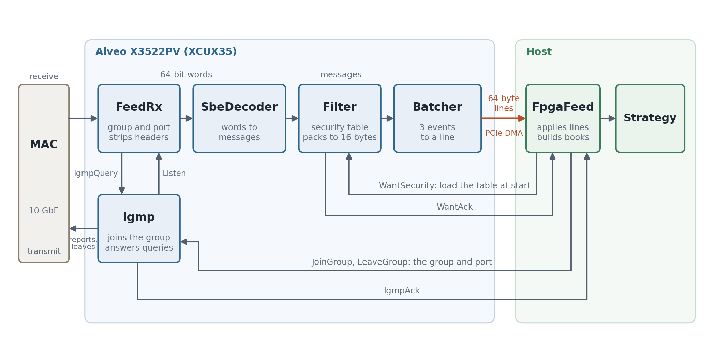

# The MDP3 handler: actors and flow

The card takes CME's MDP3 feed off the wire and sends the CPU only what the strategy
trades, packed into 64-byte lines. Four actors run on the card and one on the CPU.



```
MAC --frames--> FeedRx --words--> SbeDecoder --messages--> Filter --events--> Batcher --lines--> CPU: FpgaFeed --> strategy
```

| actor | where | code | takes | sends |
|---|---|---|---|---|
| FeedRx | card | `include/mdp3fpga/feed_rx.hpp` | Ethernet frames, as words | MDP3 packets, as words |
| SbeDecoder | card | `include/mdp3fpga/decoder.hpp` | MDP3 packets, as words | one message per entry, EndOfPacket |
| Filter | card | `include/mdp3fpga/feed.hpp` | decoder messages; WantSecurity from the CPU | PackedEvent, EndOfPacket; WantAck to the CPU |
| Batcher | card | `include/mdp3fpga/feed.hpp` | PackedEvent, EndOfPacket | EventLine, EndLine |
| FpgaFeed | CPU | `host/fpga_feed.hpp` | lines; WantAck | WantSecurity; one call per packet to the strategy |

The processes that run the card's actors, and the FIFOs between them, are in
`hls/feed_top.cpp`. All paths here are relative to `actors/fpga/mdp3/`.

## How an actor runs on the card

Each actor on the card is its own process, an `hls::task`: a circuit that runs from
reset and never returns. Its task function in `hls/feed_top.cpp` is called every clock
and takes one step. The actor's state is a `static` object, so its members are
registers that keep their values from one clock to the next. Actors are joined by
FIFOs declared at the top level, one writer and one reader each; a send is one write
into a FIFO, and a full FIFO stalls the sender.

There are two kinds of actor here.

- **Stream actors**, FeedRx and SbeDecoder, take raw words, not messages, because
  wrapping each 8-byte word in a 64-byte message would waste the link. They have no
  message handlers. Each clock their task calls `on_step()`, which reads at most one
  word.
- **Message actors**, Filter and Batcher, have handlers listed in `KFPGA_HANDLERS`, as
  CPU actors list theirs with `MESSAGE_HANDLER`. Each clock their task calls
  `proc.step(ports)`, which reads one message, calls the handler for its type, and
  writes what the handler sent.

All four take one step per clock (II = 1). The design was placed and routed on the
card's XCUX35 at 3.32 ns, about 300 MHz; it runs at 250 MHz.

## Where the actors are wired together

Everything is wired in `hls/feed_top.cpp`, in two forms of the same design: the
hardware, where the actors run at the same time, and a plain C++ version, where they
are called one after another.

### On the card: four tasks joined by FIFOs

The top function declares every FIFO and starts each actor's process as an `hls::task`:

```cpp
hls_thread_local WordStream frames("frames");   // MAC -> FeedRx
hls_thread_local WordStream words("words");     // FeedRx -> SbeDecoder
hls_thread_local Fifo decoded("decoded");       // SbeDecoder -> Filter
hls_thread_local Fifo kept("kept");             // Filter -> Batcher
hls_thread_local Fifo lines("lines");           // Batcher -> the CPU
hls_thread_local Fifo to_filter("to_filter");   // the CPU -> Filter (WantSecurity)
hls_thread_local Fifo acks("acks");             // Filter -> the CPU (WantAck)

hls_thread_local hls::task rx(rx_task, frames, words);
hls_thread_local hls::task decoder(decoder_task, words, decoded);
hls_thread_local hls::task filter(filter_task, decoded, kept, to_filter, acks);
hls_thread_local hls::task batcher(batcher_task, kept, lines);
```

Each `hls::task` is a circuit of its own. Nothing calls it: it starts at reset, and
every clock it takes one step if it has input and room for output. All four run at
once, so while Batcher handles one event, Filter handles the next, SbeDecoder reads
the next word and FeedRx the next part of a frame. The FIFOs are the only connection
between them; the order of a task's arguments is which FIFO it reads and which it
writes.

The rest of the top function (`load`, `words_in`, `lines_out`) is test harness for
co-simulation, which counts words in and lines out; on the card the MAC feeds
`frames` and the DMA engine drains `lines` instead.

### In plain C++: one call per clock

For tests over whole recordings, the same task functions are compiled with an
ordinary compiler (`MDP3_SW`) and called one after another, each call standing for
one clock of that actor:

```cpp
void mdp3_feed_tick(WordStream &frames, WordStream &words, Fifo &decoded, Fifo &kept, Fifo &window, Fifo &acks,
                    Fifo &out)
{
  rx_task(frames, words);
  decoder_task(words, decoded);
  filter_task(decoded, kept, window, acks);
  batcher_task(kept, out);
}
```

One call of `mdp3_feed_tick` is one clock of the whole card: every actor takes one
step, in the order of the flow. The FIFOs are the same, here software queues. The test
(`hls/tb_feed_stream.cpp`) puts the frames of a recording into `frames` at line rate,
calls `mdp3_feed_tick` once per clock, and reads `out`.

The two forms run the same code: the task functions, the actors, and the FIFOs between
them. What differs is only who advances the clock: the hardware, with all tasks at
once, or this function, with one call each in turn. That is how every recording was
checked before the Verilog was co-simulated.

## FeedRx

The first actor on the wire. It takes Ethernet frames from the MAC and passes on only
the MDP3 packets of one multicast group and port, channel A's, with their Ethernet,
IP and UDP headers removed. Everything else is dropped: other channels, feed B, the
recovery feeds, anything that is not IPv4 UDP.

- **Called by** `rx_task()`, which calls `rx.on_step(frames, words)` every clock.
- **Kind:** stream actor, words in and words out. It sends no messages, so it is in no
  group: its task holds it as `static FeedRx rx`.
- **States:**
  - `kHeader` stores the first six words, which hold every header, then `decide()`
    checks them in one step: optional VLAN tag, IPv4 without options, UDP, the
    configured group and port.
  - `kBody` sends the payload one word per clock. The payload starts 2 bytes into a
    word (6 with a VLAN tag), so each word out joins the end of one word in to the
    start of the next. The UDP length marks the end, so Ethernet padding is dropped.
  - `kDrain` discards the rest of a frame that is not ours.
- **Settings:** the group and port, from the build for now (`224.0.31.68:14344`).
- **Not built yet:** joining the multicast group (IGMP), and the CPU setting the group.
  See the comments in `feed_rx.hpp`.

## SbeDecoder

Decodes each MDP3 packet as its bytes arrive, storing nothing, and sends Filter one
message per item.

- **Called by** `decoder_task()`, through `proc.step_stream<SbeDecoder>(ports, in)`,
  which calls `on_step(in)` every clock and then writes out what it sent.
- **Kind:** stream actor with messages out. It receives no messages, so it has no
  handlers; it holds an `ActorRef`, `filter`, and sends with `filter.send(m, this)`.
- **Sends:**

  | message | for |
  |---|---|
  | `BookEntry` | each MBP book entry, template 46 |
  | `Trade` | each trade, template 48 |
  | `SecurityStatus` | template 30 |
  | `ChannelReset` | each entry of template 4 |
  | `EndOfPacket` | every packet: its sequence number, counts, cycle stamps |

  Every other template is skipped by its message size.
- **How:** a two-word window gives up to 8 bytes per clock from any byte offset, and a
  state machine says what they are: packet header, message header, root block, group
  header, entry, or bytes to skip. A root block or entry fills a 32-byte register, and
  decoders generated from CME's XML read its fields at fixed offsets.
- **Cost:** about 8 clocks per packet beyond the time its words take to arrive.

## Filter

Keeps what the strategy trades and drops the rest, so that only those events cross
PCIe.

- **Called by** `filter_task()`, through `proc.step(ports)`.
- **Kind:** message actor, two ports: port 0 from SbeDecoder and to Batcher, port 1 from
  and to the CPU.
- **The security table** (`table_`) is the list of securities the strategy wants: up to
  64 security ids, loaded by the CPU at start. Each lookup compares the id against
  every entry at once, in one clock. A security's position in the table, its index,
  replaces the 4-byte security id in every event; the CPU knows which id each index is.
- **Handlers:**

  | handler | message | does |
  |---|---|---|
  | `on_book` | BookEntry | outright bids, offers and book resets of a security in the table: packed and passed. Implied entries and other securities: dropped. |
  | `on_trade` | Trade | passed if the security is in the table, with the aggressor side |
  | `on_status` | SecurityStatus | always passed: CME sends status for a whole group, with no security id |
  | `on_reset` | ChannelReset | always passed: it clears every book |
  | `on_end` | EndOfPacket | always passed, so the CPU sees every sequence number |
  | `on_want` | WantSecurity | from the CPU: stores a security id at an index, replies WantAck, which says whether it was stored |

- **Packs** each kept event to 16 bytes: price, size, order count, index, level, action,
  side (layout in `include/mdp3fpga/events.hpp`).

## Batcher

Packs Filter's events into 64-byte lines, the unit the CPU reads, and ends every packet
with exactly one End line. The last actor on the card.

- **Called by** `batcher_task()`, through `proc.step(ports)`.
- **Kind:** message actor. Its `ActorRef cpu_feed` is the CPU actor FpgaFeed.
- **Handlers:**

  | handler | message | does |
  |---|---|---|
  | `on_event` | PackedEvent | with two events held, sends an `EventLine` of three; otherwise holds it |
  | `on_end` | EndOfPacket | sends `EndLine<N>`: the N events held, 0 to 2, and the packet's sequence number |

- **Examples:** 0 events sends `EndLine<0>`; 3 events send an `EventLine`, then
  `EndLine<0>`; 5 events send an `EventLine` and then `EndLine<2>`.
- **Timing:** nothing waits for a timer or a later packet; at most one line every 12
  clocks.

## What the CPU receives, and how often

**A line carries events, not MDP3 messages.** An MDP3 message can hold many entries: one
template 46 message may update a dozen price levels. SbeDecoder turns each *entry* into a
message for Filter, and Filter turns each kept entry into one 16-byte *event*. So a line
of three events is three book updates or trades, which may have come from one MDP3
message or from three.

**Each send is one line, and a line is one message to the CPU actor.** A full line,
`EventLine`, carries three events. Every packet also ends with exactly one `EndLine`,
carrying the 0 to 2 events left over and the packet's sequence number. FpgaFeed waits for
the End line, then handles the whole packet at once.

**The clock.** The card runs at 250 MHz: one clock is 4 ns, and every actor takes one step
per clock.

**How often lines are sent.** Lines follow the data, not a timer:

- one End line per packet, always;
- one more line for every three events beyond the two the End line carries.

So a packet with `n` events for us sends `floor(n / 3)` EventLines, one each time three
events have built up, and then its End line with the `n mod 3` left over.

**Packets of very different sizes.** Packets carry anything from no MDP3 message at all to
dozens of entries. A packet is at most about 1,420 bytes, and a book entry is 32 bytes, so
the most entries a packet can carry is about 44; a packet of 100 entries does not occur.

| packet | events for us | lines to the CPU |
|---|---|---|
| heartbeat, no messages | 0 | 1: `EndLine<0>` |
| one book update | 1 | 1: `EndLine<1>` |
| two updates | 2 | 1: `EndLine<2>` |
| five updates | 5 | 2: `EventLine` (1-3), `EndLine<2>` (4, 5) |
| a full packet, 44 updates, all ours | 44 | 15: fourteen `EventLine`s, then `EndLine<2>` |
| a full packet, none of it ours | 0 | 1: `EndLine<0>` |

A big packet does not make the CPU wait for its end to start receiving: its EventLines
leave while the packet is still arriving, one as each third event is decoded. The CPU
still acts only at the End line, so the strategy sees the packet complete.

**How fast lines can come.** An entry is 32 bytes, so it takes SbeDecoder four clocks, and
three events take at least twelve: Batcher sends at most one line every 12 clocks, 48 ns.
On a 10 GbE link the wire is slower than that: 32 bytes arrive every 25.6 ns, so three
entries take 77 ns, and a line every 77 ns is the most a full packet of wanted entries
can produce.

**What it comes to on real traffic.** One session of channel 344, with the six busiest
securities in the table:

| | |
|---|---|
| packets | 30,044,560 |
| events sent to the CPU | 26,375,349 |
| lines sent to the CPU | 30,612,938 |
| of which End lines | 30,044,560, one per packet |
| of which full lines (`EventLine`) | 568,378 |
| most events in one packet | 37 |

Most packets carry one or two events for us, or none, so nearly every packet is a single
End line, and only busy packets send more.

## From Batcher to the CPU

1. `cpu_feed.send(line, this)` puts the line in Batcher's outbox.
2. The step writes it to port 0, the FIFO `lines`, the last FIFO on the card.
3. `lines` leads to the design's output port, a 512-bit AXI-Stream: one line per word.
4. On the card, a PCIe DMA engine writes each line into the lane, a ring in host memory.
   **Not built yet**, with the MAC.
5. On the CPU, FpgaFeed's `FpgaLanes` mailbox polls the ring and calls its handler for
   each line.

In the tests the DMA engine is replaced: co-simulation reads the output port directly,
and the end-to-end test (`host/feed_run.cpp`) runs the card in `SoftCard` with its lines
going into a real lane ring read by the real FpgaFeed.

## FpgaFeed (CPU)

An ordinary Kaspar actor on a `FpgaLanes` mailbox. It polls the ring on its own thread,
so nothing sleeps and nothing is woken.

| handler | does |
|---|---|
| `on_start` | sends a WantSecurity for each security, to load Filter's table |
| `on_ack` | counts the acks; when all are in and none refused, calls `on_ready`, and market data starts |
| a line handler | copies the line's events to a buffer |
| an End line | checks the sequence number and sets the gap flag on a skip; if the packet had events, applies them to its MBP books and calls the strategy once with the books and the events |

The strategy gets one call per packet that had events:
`on_packet(books, events, n, gap)`. Turning that into the messages `light22` takes
today is not built yet.

## Start-up

1. FpgaFeed is created with the list of securities, at most 64.
2. On start it sends one `WantSecurity(index, security id)` per security.
3. Filter stores each and replies `WantAck`.
4. When every entry is acked, FpgaFeed calls `on_ready`, and packets are let in.

## One packet, end to end

A packet with seven book entries, five for securities in the table and two implied:

1. **FeedRx** reads the six header words, keeps the frame, and passes the payload one
   word per clock.
2. **SbeDecoder** reads the headers, then sends a `BookEntry` every four clocks, and an
   `EndOfPacket` after the last.
3. **Filter** drops the two implied entries, packs the five to `PackedEvent`s, and passes
   the `EndOfPacket`.
4. **Batcher** sends an `EventLine` of events 1 to 3, then at the end an `EndLine<2>`
   with events 4 and 5 and the sequence number.
5. **FpgaFeed** buffers the first line, and at the End line checks the sequence, applies
   the five events to its books, and calls the strategy once.

## See also

- `DESIGN.md`: the design in full, including the message and event formats.
- `../HLS.md`: how actors map onto the FPGA, and what HLS taught us.
- Each actor's source file, which documents it in detail.
