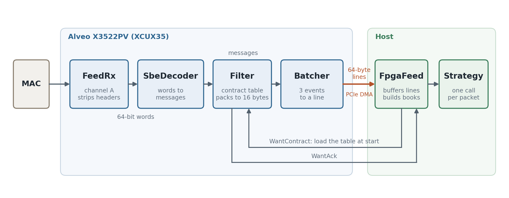
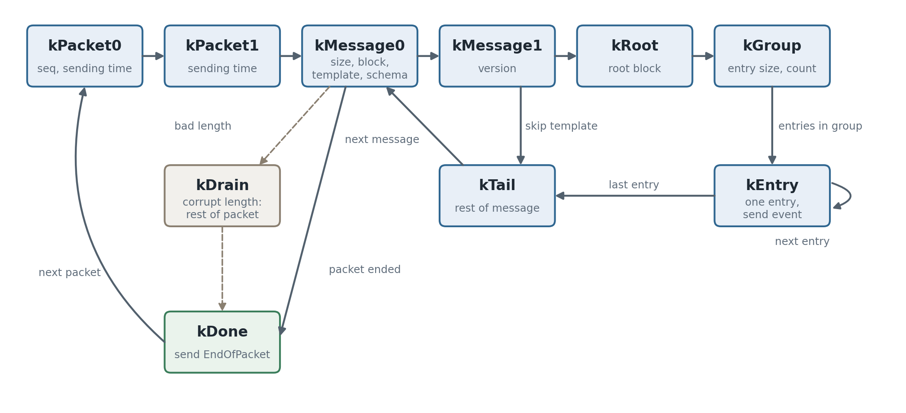
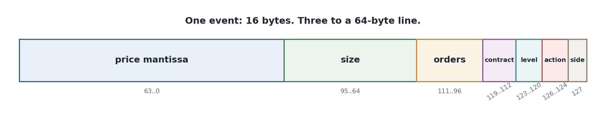

# The MDP3 handler on the card: design

The system on the Alveo X3522PV takes CME's MDP3 incremental feed from the wire,
decodes it, keeps what the strategy trades, and delivers it to the host in 64-byte
lines. It keeps no order book: the host builds the MBP books from the events the card sends. Every stage is an FPGA actor
(`kfpga`, see [../HLS.md](../HLS.md)), running as its own `hls::task`.

## System



| actor | input | output | state |
|---|---|---|---|
| **FeedRx** | Ethernet frames, 64-bit words | UDP payloads of one group and port, realigned | header words, offset, payload bytes left |
| **SbeDecoder** | UDP payload words | one message per entry, EndOfPacket | window, parser state, entry register |
| **Filter** | decoder messages; WantContract from the host | PackedEvent, EndOfPacket; WantAck to the host | contract table |
| **Batcher** | PackedEvent, EndOfPacket | EventLine | the line being filled |
| **FpgaFeed** (host) | lines | packets to the strategy | line buffer, books |

Each actor takes one step per clock. FIFOs are declared at the top level and plugged
into the processes. `SbeDecoder` and `FeedRx` run on `Group::step_stream` and
`step_raw`, their input being words and not messages; `Filter` and `Batcher` run on
`Group::step`.

The top-level FIFOs between decoder and filter and between filter and batcher are 64
envelopes deep.

## Actors, messages and handlers

Packets reach the card through the network port, which is wired to the FPGA. No CPU,
socket or kernel is involved. The MAC turns the wire into 64-bit words for FeedRx.

`FeedRx` and `SbeDecoder` have no handlers, their input being raw words. `SbeDecoder`
sends these to `Filter`:

| message | when |
|---|---|
| `BookEntry` | each MBP book entry (template 46) |
| `Trade` | each trade entry (template 48) |
| `SecurityStatus` | template 30 |
| `ChannelReset` | template 4 |
| `EndOfPacket` | the packet is finished, with its sequence number |

`Filter` handlers:

| handler | what it does |
|---|---|
| `on_book` | drops implied entries and unwanted contracts, packs the rest, sends `PackedEvent` |
| `on_trade` | sends `PackedEvent` if the contract is wanted |
| `on_status` | always sends `PackedEvent`: CME sends status for the group, with a null security id |
| `on_reset` | always sends `PackedEvent`: a reset affects every contract |
| `on_end` | always forwards `EndOfPacket` |
| `on_want` | stores a contract in the table, replies `WantAck` to the host |

`Batcher` handlers:

| handler | what it does |
|---|---|
| `on_event` | holds events; sends a full line when more follow, and starts the next |
| `on_end` | sends the End line: the packet's sequence number and up to 2 events |

`FpgaFeed` handlers, on the host:

| handler | what it does |
|---|---|
| `on_start` | sends `WantContract` for each contract, to load the filter table |
| `on_ack` | counts acks until the table is loaded |
| `on_line` | copies the line's events to a buffer |
| `on_line`, End line | checks the sequence number, sets the gap flag on a skip, applies the packet's events to the books, and calls the strategy once if there were events |

The strategy gets one call per packet: `on_packet(books, events, n, gap)`.

## FeedRx

The MAC delivers frames as 64-bit words with the FCS removed.

```
frame = Ethernet (14, or 18 with an 802.1Q tag) | IPv4 (20) | UDP (8) | payload
```

The first six words hold every header, so the accept decision is taken in one step: an
IPv4 frame without options, protocol UDP, addressed to the configured group and port.
Anything else is dropped. The payload starts 2 bytes into word 5, or 6 with a tag, so each
output word is the tail of one input word and the head of the next. The UDP length gives
the end of the payload, which removes Ethernet padding. The group and port are set at
build time.

## SbeDecoder

```
packet  = MsgSeqNum (4) | SendingTime (8) | message ...
message = MsgSize (2) | SBE header (8) | root block | groups ...
```

The decoder stores nothing. A two-word window yields up to 8 bytes per clock from any
byte offset, so misalignment costs no throughput, and a state machine tracks the position
in the packet:



| state | reads |
|---|---|
| `kPacket0`, `kPacket1` | packet header |
| `kMessage0`, `kMessage1` | message header: size, block length, template, schema, version |
| `kRoot`, `kRootRest` | root block, and what lies beyond the register |
| `kGroup` | group header: entry size, entry count |
| `kEntry`, `kEntryRest` | one group entry, and what lies beyond the register |
| `kTail` | the rest of the message, skipped |
| `kDrain` | the rest of a packet with a corrupt length |
| `kDone` | end of packet |

Root blocks and entries are collected in a 32-byte register. When complete, generated
decoders (`gen_decoder.py`, from CME's XML template) read it at fixed offsets. Blocks are
stepped by the lengths on the wire, so a later schema with longer blocks still decodes.

At most one message is sent per step. Each template is treated as follows, against what
`handler_if.hpp` does with it on the CPU today:

| template | on the CPU today | on the card |
|---|---|---|
| 46 MBP book | books | decoded |
| 48 trades | books | decoded |
| 30 security status | every book, for halt state | decoded |
| 4 channel reset | every book | decoded |
| 47 MBO book | `TachBook` | skipped: the host's book is built from MBP |
| 37 volume | binrec only | skipped |
| 50 limits and banding | binrec only | skipped |
| 51 session statistics, 49 daily statistics | empty handlers | skipped |
| 54, 55, 56 instrument definitions | security id to asset map, RefData | skipped: the host gets them from the instrument feed |
| 12 admin heartbeat | none | skipped |

Skipped templates are passed over by MsgSize, as is the order group of 46 and 48.

The packet length is known only at the last word, so nothing can be checked against it
in advance. A corrupt MsgSize ends the walk of that packet. A truncated message may
already have sent events. The EndOfPacket is sent regardless.

The decision of how many bytes a step takes sets where the next step reads, and is the
timing-critical path of the design. It is made from the state and from flags held ready in
registers (`msg_ge8_`, `rest_ge8_` and their `gt8` pairs), not from comparisons in the
step, and a truncated packet changes the state only.

**Sequence numbers.** The decoder repairs nothing and checks nothing: every EndOfPacket
carries the packet's sequence number on to the host, which detects gaps. There is no
recovery from the snapshot feed.

## Filter

`Filter` holds a table of 64 security ids with a comparator on each entry, so that a lookup
takes one step. It:

- drops implied entries, keeping outright bids, offers and book resets
- drops contracts outside the table
- packs each surviving event to 16 bytes
- passes channel resets and security status always. CME sends status for the group, with
  a null security id, and the host's books use it for halt state
- passes EndOfPacket always, so the host sees every packet's sequence number

The host fills the table at start through its own link: one WantContract per contract, each
answered by a WantAck. It sends no market data until every entry is acknowledged, and the
index it assigns is the contract's number in every later event.

## Batcher

`Batcher` holds events in registers and sends a 64-byte line when it is full and more
follow. At EndOfPacket it sends the End line, which carries the packet's sequence number
and up to 2 events. If more events are held than fit, a full line goes first. A packet with
no event for us is an End line with no events. Hence every packet produces exactly one End
line, nothing waits for a later packet, and there is one send per step, so the actor runs at
II = 1.

## Host interface

Lines are written into a ring in host memory, one writer and one reader, and consumed
through the framework's `CpuEnd` and `FpgaLanes` mailbox, which polls. `FpgaFeed` copies a
packet's lines to a buffer. At the End line it checks the sequence number, setting a gap flag
that stays set if a packet was skipped, and if the packet had events it applies them to its
MBP books and hands the books and events to the strategy in one call on that thread. Nothing
sleeps and nothing is woken, and the kernel is not on the receive path.

### Messages to the host

| message | id | contents |
|---|---|---|
| `EventLine` | 331-333 | 1 to 3 events; the id gives the number |
| End line | 334-336 | the packet's sequence number and 0 to 2 events; the id gives the number |
| `WantAck` | 339 | table index |

From the host, `WantContract` (338): table index and security id.

### Event format

Each event is 16 bytes:



| bits | field |
|---|---|
| 63..0 | price mantissa, exponent -9 |
| 95..64 | size |
| 111..96 | order count |
| 119..112 | contract, the index in the filter's table |
| 123..120 | level, or the kind of an action 7 event |
| 126..124 | action: MDUpdateAction 0 to 5, 6 trade, 7 other |
| 127 | 1 for an offer; for a trade, set if the aggressor is the seller |

For action 7 the level field gives the kind: 0 security status, 1 channel reset, 2 book reset.
A security status event also carries trading status, halt reason and trading event.

## Clocks and timing

The HLS target is 4 ns, 250 MHz, on one clock. At 8 bytes per clock this exceeds 10 GbE line
rate. Crossing from the MAC's clock domain, if it differs, is not yet designed. Decoder,
filter and batcher were placed and routed at 3.37 ns on the KU5P stand-in, before the End
flag, the table loading and FeedRx were added.

## Outside this design

The MAC and PCIe DMA engine are not built, and their interfaces here are assumed: a 64-bit
stream from the MAC, and a stream of 64-byte lines toward the host. The order path is a
separate project ([../ILINK_PLAN.md](../ILINK_PLAN.md)). `BookBank`
(`include/mdp3fpga/book.hpp`) is retained as a design for a book on the card and is not
part of this system; it does not synthesize as written.
