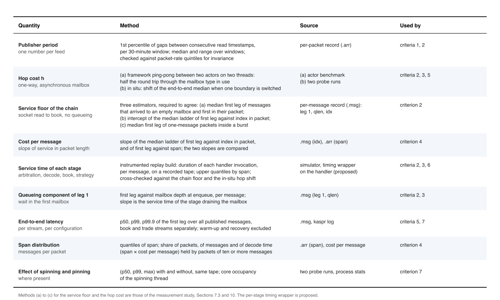
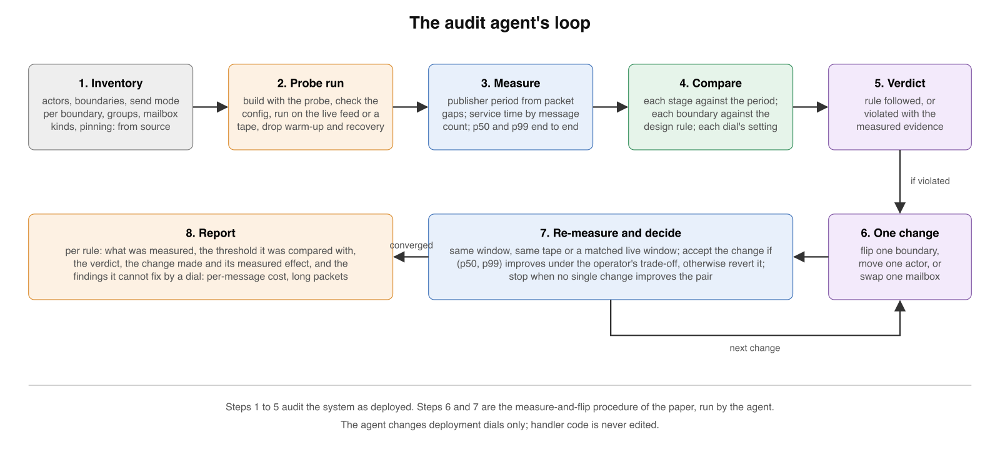
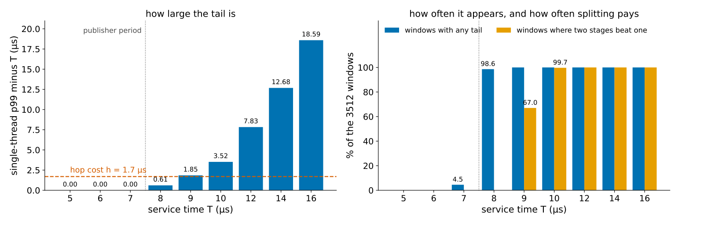
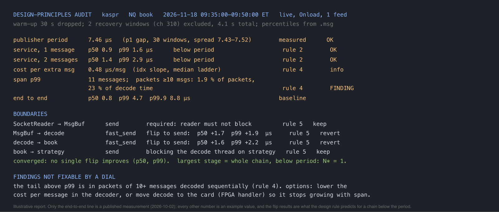

# An Agent That Audits Kaspar-HFT System for best Design Principles

*An AI agent that measures a running Kaspar-HFT system against the design principles, reports which principles the system satisfies, and adjusts the deployment parameters until measurement shows no further improvement.*

Vincent Mayeski, M2 Tech, Montreal

## 1. Introduction

The [preceding article](https://rawcdn.githack.com/vincent212/kaspar-hft/2db763f8d9dff708a0e9215ea194acb141e8d87e/substack/hft-design-principles/index.html) derived four design principles for market-data receivers from over one year of CME packet data, together with a design flow that applies them. The principles are stated in terms of measured quantities: the publisher period of the feed, the per-packet service time of each stage under load, the cost of a thread hop, and the number of messages per packet. These quantities are properties of the feed and of the deployment, and they are not determined by the source code. The same compiled actor code satisfies the principles on one feed and violates them on another, or satisfies them at one message count per packet and violates them at a higher one.

Whether a deployed system satisfies the principles is therefore established by measurement on the assembled system, against the feed on which it will operate, and the measurement is repeated after each change to the deployment. The procedure has a fixed sequence of steps, fixed instruments and a fixed set of criteria. In Kaspar-HFT the instruments exist and the criteria are documented, which makes the procedure suitable for execution by a coding agent. This article describes that agent: the quantities it observes, the criteria it applies, the parameters it is permitted to change, and the form of its report. As with the [venue generator](https://vincentmayeski.substack.com/p/global-connectivity-for-kaspar-hft), the agent is a skill for Claude Code, stored in the repository and executed within a copy of it. The measurement tooling it uses is present in the repository; the skill that drives it is the design presented here.

## 2. The criteria

The design flow of the measurement study comprises ten steps. Expressed as criteria that a running system either satisfies or does not, they reduce to the eight of Figure 1. The first seven follow from the measurement study. The eighth is taken from the documentation of the latency probe, which specifies the conditions under which a latency figure obtained from the probe is valid.

*Figure 1. The eight criteria the agent applies. For each: the quantity measured, its source in Kaspar-HFT, and the condition under which the agent reports a violation.*

Three of the criteria require elaboration.

Criterion 1 requires that the publisher period be measured on the target feed. On NQ the period is approximately 7.5 μs and was invariant between quiet and volatile sessions; this is a property of one feed's publisher and is not assumed to hold elsewhere. The agent obtains the period from the first percentile of the distribution of gaps between consecutive packets. The mean gap is approximately three hundred times the period and is not used.

Criterion 2 compares the service time of a stage with the publisher period using the upper quantiles of service under load. A stage whose median service time is below the period and whose 99th percentile exceeds it accumulates a queue on the packets that determine the latency tail.

Criterion 8 concerns the validity of the measurement itself. Percentiles are computed from the per-message records. The maxima of the 100 ms bins overstate the per-message 99th percentile by a measured factor of approximately 1.7 and are not used. Recovery windows are excluded, because during recovery incoming packets accumulate and are subsequently charged the full duration of the backlog as latency. The initial minutes of a run are excluded. The presence of the probe in the build is confirmed from the startup log, since a build without the probe flag runs without error and records no data.

## 3. Observable quantities

For the running system the agent uses the latency probe present in Kaspar-HFT and is limited to the quantities the probe records; per-stage timing, described in Section 4, requires an instrumented replay build. Figure 2 shows the market-data path and the three timestamps taken on it.

*Figure 2. The market-data path of Kaspar-HFT and the probe's three timestamps. The socket reader timestamps each packet when the read call returns; the order book timestamps each update at publication; the probe, a subscriber to the book, timestamps each update on entry to its handler. Red boundaries are asynchronous mailboxes; black boundaries are synchronous calls on the same thread. The probe also records the depth of the first mailbox at the moment each packet is enqueued.*

A run produces two records. The per-packet record contains the read timestamp, the sequence number and the span, which is the number of messages in the packet. The per-message record contains the publication timestamp, the first leg, the mailbox depth at enqueue, and the index of the message within its packet. The quantities required by the criteria are derived from these. The gaps between consecutive read timestamps give the publisher period. The first leg as a function of span gives the service time as a function of packet length: an intercept for a one-message packet and a slope per additional message, which is the per-message cost required by criterion 4. The first leg as a function of index within the packet gives the same slope by a second method. The first leg as a function of mailbox depth gives the queueing component of the leg.

The probe's documentation specifies its limits, and the agent is subject to the same limits. No timestamp is taken between the socket read and the book publication, so the first leg comprises five components: the remainder of the read loop, the wait in the first mailbox, the decode, a second mailbox hop, and the book update. The first leg alone does not identify which component contributed to a given value. The agent therefore attributes service time to a stage by differential measurement: it changes one boundary, repeats the measurement, and attributes the difference to the stage isolated by the change. Nothing preceding the socket read is observed, so none of the agent's figures is a wire-to-wire latency. All counts are over messages published by the book, not over messages received, because the book suppresses updates that leave the top of book unchanged before the probe observes them.

## 4. Measurements

The agent makes every measurement the criteria require. Figure 3 lists them with the method for each. The methods for the publisher period, the hop cost and the service floor are those of the measurement study; the per-stage timing is proposed.

*Figure 3. The measurements the agent makes, the method and data source for each, and the criteria that use each one.*

**Publisher period.** From the per-packet record, the agent forms the distribution of gaps between consecutive read timestamps within each 30-minute window and takes its first percentile. The result is reported as the median over windows with its range. The agent also computes the first-percentile gap within each quintile of packet rate; on NQ the measurement study found it constant at 7.43 to 7.53 μs while the rate varied by a factor of four, and the agent reports whether the same holds on the feed under test. The mean gap is reported separately and is not used in any criterion.

**Hop cost.** The one-way cost of an asynchronous boundary is obtained in two ways and both are reported. The first is the framework's own benchmark: two actors on two threads exchange a message and its reply through the mailbox type in use, and the hop cost is half the median round trip. On the reference host this gives approximately 3.4 μs round trip through the default mailbox, so 1.7 μs one way; 90 ns for two actors in a group on one thread; and 30 ns for a synchronous call. The second is in situ: the measurement study found that the end-to-end median is the service time plus one hop cost per asynchronous boundary in almost every cell of its sweep, so the shift in the end-to-end median between two probe runs that differ in one boundary's delivery mode is a direct measurement of that boundary's hop cost on the live path. Disagreement between the two beyond a few hundred nanoseconds is reported.

**Service floor of the chain.** The time from socket read to book publication for a message that encountered no queueing is obtained by the three estimators of the measurement study, which the agent requires to agree. The first is the median first leg over messages that were enqueued when the first mailbox was empty and were first in their packet; for these neither queueing nor the decode of preceding messages in the same packet contributes. The second is the intercept of the median ladder of first leg against index within the packet. The third is the median first leg of one-message packets inside a burst, identified from the per-packet record as packets spaced one publisher period apart. On the two-stage receiver of the measurement study the three estimators gave 7.0 to 7.5 μs on each of three instruments; on the single-threaded receiver the floor is below 1 μs.

**Cost per message.** The slope of the median ladder of first leg against index within the packet is the time to decode and apply one additional message. The same slope is obtained from first leg against span, and the two are compared. The cost per message, with the service floor, gives the service time of a packet of any length, which criterion 2 compares with the publisher period at the upper quantiles of span.

**Service time of each stage.** The probe takes no timestamp between the socket read and the book publication, so the service of an individual stage is not available from the probe. The agent obtains it from an instrumented build run in the simulator on a recorded tape, in which a timing wrapper records the duration of each handler invocation per message. The actors, the messages and the handlers are those of production; the simulator supplies the packets with their recorded timestamps. From this the agent has, for arbitration, decode, book and strategy separately, the median and upper quantiles of service by span. The sum over stages is checked against the chain floor measured live, and the difference is attributed to the hand-offs and compared with the in-situ hop cost. This instrumentation is proposed; it is a change to the framework's dispatch loop and not to any handler.

**Queueing component.** From the per-message record, the first leg against the mailbox depth at enqueue gives, by regression, the time a message waits per message ahead of it, which is the service time of the stage that drains the mailbox. This is a second estimate of that stage's service time, taken on the live path.

**End-to-end latency.** The median, 99th and 99.9th percentiles of the first leg over all published messages, for the book stream and the trade stream separately, with warm-up and recovery windows excluded. This is the quantity compared between configurations in the change loop.

**Span distribution.** The quantiles of messages per packet, and the share of packets, of messages and of decode time held by packets of ten or more messages, where decode time is span multiplied by the cost per message. This is the measurement behind the finding of criterion 4.

**Effect of spinning and pinning.** Where the inventory records a spinning mailbox type or a pinned busy-polling thread, the agent runs the probe with and without it on the same tape and reports the median, 99th percentile and maximum of each, together with the core occupancy of the spinning thread from process statistics.

## 5. Procedure

*Figure 4. The agent's procedure. Steps 1 to 5 evaluate the system as deployed. Steps 6 and 7 are the measure-and-flip procedure of the measurement study, executed one change at a time. The report records both.*

**Inventory.** The agent reads the source and the configuration and records the pipeline in the terms the criteria use: the actors on the market-data path in order; at each boundary, whether the sender uses synchronous or asynchronous delivery; which actors share a thread through membership of a group; the mailbox type of each actor, which is relevant to criterion 7; which threads are pinned; and which stages carry state between packets, which determines under criterion 6 whether a stage above the period is partitioned or pooled. In Kaspar-HFT the delivery mode is selected at the sender's call site and the receiving handler is independent of it, so the inventory is a complete description of the topology, and every item in it is a deployment parameter.

**Probe run.** The agent builds with the probe enabled, verifies the configuration keys the probe requires, assigns the output to a directory specific to the variant under test, and runs for a window on the live feed or, in the simulator, on a recorded tape with the original packet timestamps. It confirms from the log that the probe was created and which decode path was active. It excludes the warm-up period and parses the log for recovery windows.

**Measurement.** The publisher period from the packet gaps; the end-to-end median and 99th percentile from the per-message records; the service intercept and the slope per message from the span and index regressions; the distribution of span; and the share of decode time attributable to long packets.

**Comparison and verdict.** The upper-quantile service time of each stage against the publisher period, which is criterion 2 and the threshold of Figure 5. Each existing partition against criterion 3: whether its removal would increase the largest stage. The delivery mode of each boundary against the prediction of criterion 5: asynchronous where the hop reduces the largest stage, synchronous elsewhere. The ordering of stage sizes against criterion 6. Any spinning mailbox or pinned thread against criterion 7: whether a measurement supports it. The run itself against criterion 8.

*Figure 5. The threshold against which each stage is compared, from the measurement study. Left: the single-thread 99th percentile minus the service time, by service time. Below the publisher period (dotted line) the excess is zero; above it, the excess exceeds the cost of one hop (dashed line) between 8 and 9 μs. Right: the share of windows with a non-zero excess, and the share in which two stages outperform one. A stage whose 99th-percentile service time lies below the dotted line is not partitioned.*

**Single change and re-measurement.** Where a criterion is violated, or where the prediction indicates that a different setting would reduce latency, the agent makes one change: it switches one boundary between synchronous and asynchronous delivery, moves one actor into or out of a group, or replaces one mailbox type. It then repeats the probe run on the same tape, or on a live window matched by time of day, and compares the median and 99th percentile with the baseline under the operator's specified weighting of the two. A change that improves the pair is retained; any other change is reverted. The procedure terminates when no single change improves the pair, which is the termination condition of the measurement study's procedure. One change is made between successive measurements, because the joint effect of two boundaries is not additive.

**Report.** Figure 6 shows the form. For each criterion: the quantity measured, the threshold applied, the verdict, and, where a change was made, the change and its measured effect. A separate section lists findings outside the scope of the deployment parameters.

*Figure 6. An illustrative report for the single-threaded NQ book handler. The end-to-end line is a published measurement; all other values are examples. The flip results are those predicted by the design rule for a chain below the publisher period: each additional hop increases latency without reducing queueing, each is reverted, and the procedure terminates at the single-threaded configuration. The final section lists the finding that lies outside the deployment parameters.*

## 6. Scope of the agent's changes

The agent changes deployment parameters only: the delivery mode of a boundary, the assignment of actors to groups, the mailbox type of an actor, and the pinning of a thread. In Kaspar-HFT each of these is a configuration value or a single-line change at a call site, and none affects a handler, a message type or a test. The system after any such change passes the same tests as before, and the measured latency is the only quantity that differs.

The agent does not change the code within a stage. Criterion 4 states that for a chain below the publisher period, the residual tail arises from packets containing many messages, decoded sequentially, and from service-time variance. The agent measures both: the slope per message, and the share of packets, messages and decode time held by long packets. On the NQ book stream the measurement study found that packets of ten or more messages constitute under 2% of packets and several times that share of messages; on ZN trade, 11% of packets contain 66% of the messages and consume 86% of the decode time. A finding of this kind is not addressed by a deployment parameter. The agent reports it with the two available interventions, both outside its scope: reduction of the decoder's cost per message, or migration of the decode to the FPGA handler, where the work remaining after a packet's last byte is independent of packet length.

Findings under criterion 7 are likewise reported and not acted on. A spinning mailbox or a pinned busy-polling thread may be justified. The measurement study predicts that on a self-exciting feed the receiver is already active and cache-warm at the arrival of each tail-determining message, so that the intervention affects the median and the minimum and not the tail, at a steady cost in core occupancy and cache pressure. The agent measures the three quantiles with and without the intervention on the same tape and reports them with the cost. The decision is the operator's.

## 7. Invocation

The agent runs within Claude Code in a copy of the Kaspar-HFT repository, on a host that receives the feed or holds a tape. A request names the handler and the window:

> Audit the NQ book handler against the design principles on a 15-minute live window at the open.

> Audit the ES and ZN handlers on yesterday's tape and report whether any boundary should change.

The agent produces the inventory, runs the probe, applies the criteria, executes the change loop, and writes the report and the per-message records to a dedicated directory. Each retained change is a diff of one line or one configuration key and is listed in the report. No exchange credential is required; a live window requires only the multicast feed the host already receives.

## 8. Limitations

The probe measures from the socket read, so the NIC, the kernel or Onload receive path, and the wire are outside the agent's observation; a violation upstream of the socket read is not detected. The first leg is not subdivided, so attribution to a stage depends on differential measurement, which assumes that the remainder of the system was unchanged between runs. On a live feed this assumption does not hold exactly, and the agent reports live comparisons together with the packet rate and span distribution of each window. Percentiles are computed over messages published by the book, not over packets received. The change loop is a local search: it terminates at a configuration that no single change improves, as the measurement study's procedure specifies, and does not establish that this configuration is globally optimal. The criteria are those of a self-exciting feed with a bounded publisher rate; a feed with a different arrival law requires the measurement study to be repeated before the criteria can be stated. The skill itself is a design. The probe, its analysis scripts, the per-boundary delivery modes and the mailbox types are present in the repository and in use; the agent that applies the criteria to them is not yet implemented.

## 9. Conclusion

The design principles of the measurement study are stated in terms of measured quantities, and whether a system satisfies them on its feed is determined by measurement. The determination is a procedure: record the topology, run the probe under valid conditions, measure the period and the service times, compare against the criteria, change one parameter, re-measure, repeat until no change improves the result, and report. Kaspar-HFT provides the instruments and makes each topology decision a deployment parameter that can be changed without modifying code. The audit agent executes the procedure, reports which criteria the system satisfies, converges the parameters by measurement, and identifies the findings that require a change to the code rather than to a parameter.

Kaspar-HFT is open source: https://github.com/vincent212/kaspar-hft. The measurement tooling is under `kaspr/perf`; the design principles are in [arXiv:2609.32848](https://arxiv.org/abs/2609.32848).
