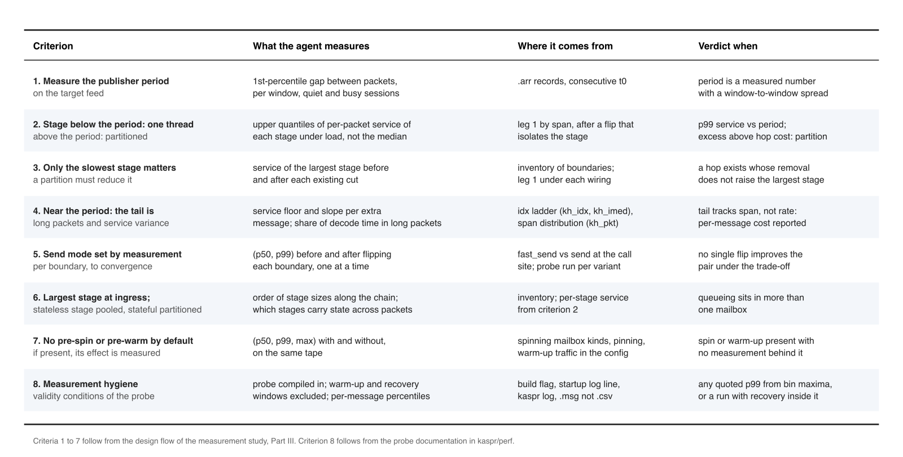
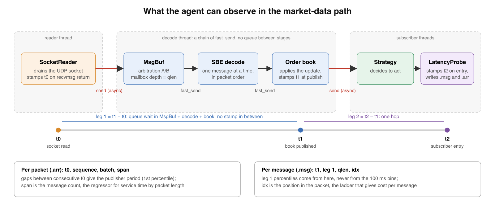
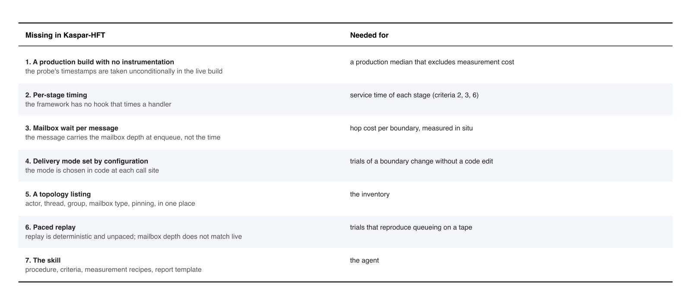

# An Agent That Audits Kaspar-HFT System for best Design Principles

*An AI agent that measures a running Kaspar-HFT system against the design principles, reports which principles the system satisfies, and proposes the architecture changes the measurements justify, each with its predicted and trial-measured effect.*

Vincent Mayeski, M2 Tech, Montreal

## 1. Introduction

The [preceding article](https://rawcdn.githack.com/vincent212/kaspar-hft/2db763f8d9dff708a0e9215ea194acb141e8d87e/substack/hft-design-principles/index.html) derived four design principles for market-data receivers from over one year of CME packet data, together with a design flow that applies them. The principles are stated in terms of measured quantities: the publisher period of the feed, the per-packet service time of each stage under load, the cost of a thread hop, and the number of messages per packet. These quantities are properties of the feed and of the deployment, and they are not determined by the source code. The same compiled actor code satisfies the principles on one feed and violates them on another, or satisfies them at one message count per packet and violates them at a higher one.

Whether a deployed system satisfies the principles is therefore established by measurement on the assembled system, against the feed on which it will operate, and the measurement is repeated after each change to the deployment. The procedure has a fixed sequence of steps, fixed instruments and a fixed set of criteria. In Kaspar-HFT the instruments exist and the criteria are documented, which makes the procedure suitable for execution by a coding agent. This article describes that agent: the quantities it observes, the criteria it applies, the proposals it produces, and the form of its report. The agent does not modify the system; it measures, evaluates each proposal on a recorded tape, and reports. As with the [venue generator](https://vincentmayeski.substack.com/p/global-connectivity-for-kaspar-hft), the agent is a skill for Claude Code, stored in the repository and executed within a copy of it. This article presents a design. The agent does not exist, and the framework as it stands does not support all of its measurements. The measurement tooling that exists is identified in Section 3, the measurements the agent requires are specified in Section 4, and the changes to Kaspar-HFT that the design requires are specified in Section 5.

## 2. The criteria

The design flow of the measurement study comprises ten steps. Expressed as criteria that a running system either satisfies or does not, they reduce to the eight of Figure 1. The first seven follow from the measurement study. The eighth is taken from the documentation of the latency probe, which specifies the conditions under which a latency figure obtained from the probe is valid.

*Figure 1. The eight criteria the agent applies. For each: the quantity measured, its source in Kaspar-HFT, and the condition under which the agent reports a violation.*

Three of the criteria require elaboration.

Criterion 1 requires that the publisher period be measured on the target feed. On NQ the period is approximately 7.5 μs and was invariant between quiet and volatile sessions; this is a property of one feed's publisher and is not assumed to hold elsewhere. The agent obtains the period from the first percentile of the distribution of gaps between consecutive packets. The mean gap is approximately three hundred times the period and is not used.

Criterion 2 compares the service time of a stage with the publisher period using the upper quantiles of service under load. A stage whose median service time is below the period and whose 99th percentile exceeds it accumulates a queue on the packets that determine the latency tail.

Criterion 8 concerns the validity of the measurement itself. Percentiles are computed from the per-message records. The maxima of the 100 ms bins overstate the per-message 99th percentile by a measured factor of approximately 1.7 and are not used. Recovery windows are excluded, because during recovery incoming packets accumulate and are subsequently charged the full duration of the backlog as latency. The initial minutes of a run are excluded. The presence of the probe in the build is confirmed from the startup log, since a build without the probe flag runs without error and records no data.

## 3. Observable quantities

For the running system the agent uses the latency probe present in Kaspar-HFT and is limited to the quantities the probe records; per-stage timing, described in Section 4, requires an instrumented replay build. Figure 2 shows the market-data path and the three timestamps taken on it.

*Figure 2. The market-data path of Kaspar-HFT and the probe's three timestamps. The socket reader timestamps each packet when the read call returns; the order book timestamps each update at publication; the probe, a subscriber to the book, timestamps each update on entry to its handler. Red boundaries are asynchronous mailboxes; black boundaries are synchronous calls on the same thread. The probe also records the depth of the first mailbox at the moment each packet is enqueued.*

A run produces two records. The per-packet record contains the read timestamp, the sequence number and the span, which is the number of messages in the packet. The per-message record contains the publication timestamp, the first leg, the mailbox depth at enqueue, and the index of the message within its packet. The quantities required by the criteria are derived from these. The gaps between consecutive read timestamps give the publisher period. The first leg as a function of span gives the service time as a function of packet length: an intercept for a one-message packet and a slope per additional message, which is the per-message cost required by criterion 4. The first leg as a function of index within the packet gives the same slope by a second method. The first leg as a function of mailbox depth gives the queueing component of the leg.

The probe's documentation specifies its limits, and the agent is subject to the same limits. No timestamp is taken between the socket read and the book publication, so the first leg comprises five components: the remainder of the read loop, the wait in the first mailbox, the decode, a second mailbox hop, and the book update. The first leg alone does not identify which component contributed to a given value. The agent therefore attributes service time to a stage by differential measurement in the simulator: it changes one boundary in a trial build, repeats the measurement on the same tape, and attributes the difference to the stage isolated by the change. Nothing preceding the socket read is observed, so none of the agent's figures is a wire-to-wire latency. All counts are over messages published by the book, not over messages received, because the book suppresses updates that leave the top of book unchanged before the probe observes them.

## 4. Measurements

The agent makes every measurement the criteria require. Figure 3 lists them with the method for each. The methods for the publisher period, the hop cost and the service floor are those of the measurement study; the per-stage timing and the per-boundary hop cost require the changes of Section 5.

*Figure 3. The measurements the agent makes, the method and data source for each, and the criteria that use each one.*

**Publisher period.** From the per-packet record, the agent forms the distribution of gaps between consecutive read timestamps within each 30-minute window and takes its first percentile. The result is reported as the median over windows with its range. The agent also computes the first-percentile gap within each quintile of packet rate; on NQ the measurement study found it constant at 7.43 to 7.53 μs while the rate varied by a factor of four, and the agent reports whether the same holds on the feed under test. The mean gap is reported separately and is not used in any criterion.

**Hop cost.** The one-way cost of an asynchronous boundary is obtained in three ways and all are reported. The first is the framework's own benchmark: two actors on two threads exchange a message and its reply through the mailbox type in use, and the hop cost is half the median round trip. On the reference host this gives approximately 3.4 μs round trip through the default mailbox, so 1.7 μs one way; 90 ns for two actors in a group on one thread; and 30 ns for a synchronous call. The second is in situ: the measurement study found that the end-to-end median is the service time plus one hop cost per asynchronous boundary in almost every cell of its sweep, so the shift in the end-to-end median between two probe runs that differ in one boundary's delivery mode is a direct measurement of that boundary's hop cost on the live path. The third is per message: with the enqueue timestamp of Section 5 in the message header, the wait in each mailbox is read directly at dequeue, which gives the hop cost per boundary rather than for the chain. Disagreement among the three beyond a few hundred nanoseconds is reported.

**Service floor of the chain.** The time from socket read to book publication for a message that encountered no queueing is obtained by the three estimators of the measurement study, which the agent requires to agree. The first is the median first leg over messages that were enqueued when the first mailbox was empty and were first in their packet; for these neither queueing nor the decode of preceding messages in the same packet contributes. The second is the intercept of the median ladder of first leg against index within the packet. The third is the median first leg of one-message packets inside a burst, identified from the per-packet record as packets spaced one publisher period apart. On the two-stage receiver of the measurement study the three estimators gave 7.0 to 7.5 μs on each of three instruments; on the single-threaded receiver the floor is below 1 μs.

**Cost per message.** The slope of the median ladder of first leg against index within the packet is the time to decode and apply one additional message. The same slope is obtained from first leg against span, and the two are compared. The cost per message, with the service floor, gives the service time of a packet of any length, which criterion 2 compares with the publisher period at the upper quantiles of span.

**Service time of each stage.** The probe takes no timestamp between the socket read and the book publication, so the service of an individual stage is not available from the probe. The agent obtains it from an instrumented build run in the simulator on a recorded tape, in which a timing wrapper records the duration of each handler invocation per message. The actors, the messages and the handlers are those of production; the simulator supplies the packets with their recorded timestamps. From this the agent has, for arbitration, decode, book and strategy separately, the median and upper quantiles of service by span. The sum over stages is checked against the chain floor measured live, and the difference is attributed to the hand-offs and compared with the in-situ hop cost. This instrumentation does not exist; it is change 2 of Section 5, a change to the framework's dispatch loop and not to any handler.

**Queueing component.** From the per-message record, the first leg against the mailbox depth at enqueue gives, by regression, the time a message waits per message ahead of it, which is the service time of the stage that drains the mailbox. This is a second estimate of that stage's service time, taken on the live path.

**End-to-end latency.** The median, 99th and 99.9th percentiles of the first leg over all published messages, for the book stream and the trade stream separately, with warm-up and recovery windows excluded. This is the quantity compared between the baseline and each trialled proposal.

**Span distribution.** The quantiles of messages per packet, and the share of packets, of messages and of decode time held by packets of ten or more messages, where decode time is span multiplied by the cost per message. This is the measurement behind the finding of criterion 4.

**Effect of spinning and pinning.** Where the inventory records a spinning mailbox type or a pinned busy-polling thread, the agent runs the probe with and without it on the same tape and reports the median, 99th percentile and maximum of each, together with the core occupancy of the spinning thread from process statistics.

## 5. Changes required to Kaspar-HFT

The repository was read on 2026-11-22 to establish what the design can use as it stands and what it requires. Figure 4 summarises the result. The latency probe, its two records, the depth-at-enqueue field in the message header, the analysis scripts, the mailbox types, actor groups, the two delivery modes with receiver transparency, and deterministic replay exist and are used without change. Eight changes are required, and the ninth item is the agent itself.

*Figure 4. The changes to Kaspar-HFT the design requires, with the present state of each as read from the repository.*

**1. A single instrumentation define.** All measurement code is placed under one compile-time define, and the production binary is built without it. At present the probe actor is compiled in under the define that also enables the order-by-order book, which is the build used for live trading, and is disabled at runtime by configuration; the three quantities the probe reads, the socket-read timestamp, the publish timestamp and the mailbox depth at enqueue, are taken unconditionally in that build. A disabled probe has no subscriber and costs nothing per message, but the two clock reads and the depth copy per update remain. Under the new define they are compiled out, so the median the production system achieves is the median without instrumentation, and the agent's measurements are made on a separate build with the define set. The cost of the instrumentation is itself measured, as the difference between the two builds on the same tape.

**2. Per-handler timing.** In the framework's dispatch loop and in the synchronous-send path, under the define, the cycle counter is read before and after each handler invocation, and a record of actor, message type, duration, packet sequence and index within packet is appended to a per-thread ring buffer that the probe actor drains to a per-stage record file. The framework has no timing hook at present. This change supplies the service time of each stage, which the probe cannot, and it is confined to the framework: no handler is modified.

**3. An enqueue timestamp in the message header.** The header already carries the depth of the destination mailbox at the moment of enqueue, written by the framework and read by the receiving handler. Under the define, the time of enqueue is written beside it and read at dequeue. The difference is the wait in that mailbox for that message, which gives the hop cost per boundary in situ and separates the queueing component of the first leg from the service component without a stamp between stages.

**4. Delivery mode as configuration.** The delivery mode of a boundary is chosen at the sender's call site, and changing it is a one-line code edit. For the agent to trial a change without editing code, the call site consults a table keyed by sender and receiver, loaded at start-up from configuration, with the code's choice as the default. The inventory of boundaries is then read from the configuration, and a trial is a configuration change in a separate directory. Receiver transparency is unaffected: the receiving handler is the same under either mode.

**5. Topology export.** The inventory requires, for every actor, its thread, its group if any, its mailbox type and its pinning. The framework holds this information but does not list it. A start-up log line per actor, or a command on the existing console of the running process, supplies it.

**6. Paced replay.** The PCAP reader feeds packets to the pipeline with timing taken from the data for the simulator's clock, which makes replay deterministic, and does not release packets at their recorded wall-clock offsets. Mailbox depth in replay therefore does not reproduce live arrivals, and a trial of a queueing proposal on a tape is not valid in this mode. A pacing mode is added in which each packet is released at its recorded offset from the start of the tape and the socket-read timestamp is taken at release. Deterministic replay remains the default for backtests.

**7. Per-stage analysis.** A script beside the existing analysis scripts joins the per-handler records of change 2 to the probe's per-message record by packet sequence and index, and reports per-stage quantiles by span.

**8. Hop-cost benchmark on the configured mailbox.** The framework's ping-pong example measures the round trip between two actors on two threads. It is parameterised by mailbox type so that the agent runs it with the type named in the configuration under test.

**9. The skill.** A skill directory in the repository holding the procedure of Section 6, the criteria of Figure 1, the measurement recipes of Figure 3, the report template of Figure 7, and references to the probe documentation and to the design flow of the measurement study.

Changes 1 to 3 are to the actor framework and the probe; 4 and 5 to the framework's configuration and console; 6 to the PCAP reader; 7 and 8 to the measurement tooling. None changes a handler, a message type or the order book.

## 6. Procedure

*Figure 5. The agent's procedure. Steps 1 to 5 evaluate the system as deployed. Steps 6 and 7 form each proposal and evaluate it on a recorded tape in a separate build. The production configuration and the code are not modified.*

**Inventory.** The agent reads the source and the configuration and records the pipeline in the terms the criteria use: the actors on the market-data path in order; at each boundary, whether the sender uses synchronous or asynchronous delivery; which actors share a thread through membership of a group; the mailbox type of each actor, which is relevant to criterion 7; which threads are pinned; and which stages carry state between packets, which determines under criterion 6 whether a stage above the period is partitioned or pooled. In Kaspar-HFT the delivery mode is selected at the sender's call site and the receiving handler is independent of it, so the inventory is a complete description of the topology, and every item in it is a deployment parameter.

**Probe run.** The agent builds with the probe enabled, verifies the configuration keys the probe requires, assigns the output to a directory specific to the variant under test, and runs for a window on the live feed or, in the simulator, on a recorded tape with the original packet timestamps. It confirms from the log that the probe was created and which decode path was active. It excludes the warm-up period and parses the log for recovery windows.

**Measurement.** The publisher period from the packet gaps; the end-to-end median and 99th percentile from the per-message records; the service intercept and the slope per message from the span and index regressions; the distribution of span; and the share of decode time attributable to long packets.

**Comparison and verdict.** The upper-quantile service time of each stage against the publisher period, which is criterion 2 and the threshold of Figure 6. Each existing partition against criterion 3: whether its removal would increase the largest stage. The delivery mode of each boundary against the prediction of criterion 5: asynchronous where the hop reduces the largest stage, synchronous elsewhere. The ordering of stage sizes against criterion 6. Any spinning mailbox or pinned thread against criterion 7: whether a measurement supports it. The run itself against criterion 8.

*Figure 6. The threshold against which each stage is compared, from the measurement study. Left: the single-thread 99th percentile minus the service time, by service time. Below the publisher period (dotted line) the excess is zero; above it, the excess exceeds the cost of one hop (dashed line) between 8 and 9 μs. Right: the share of windows with a non-zero excess, and the share in which two stages outperform one. A stage whose 99th-percentile service time lies below the dotted line is not partitioned.*

**Proposal.** For each violated criterion, and for each boundary where the design rule predicts that a different setting would reduce latency, the agent forms a proposal: one change to the topology, the criterion it addresses, and the predicted effect on the median and the 99th percentile. The prediction is read from the design rule with the measured service times: a hop added at a boundary costs the measured hop cost at the median, and reduces the tail excess only if it reduces the largest stage, by the amount tabulated in the measurement study for a stage of the resulting length. The forms a proposal can take are listed in Section 7.

**Trial in the simulator.** Each proposal that concerns a deployment parameter is evaluated before it is reported. The agent applies the proposal in a separate build directory, runs the simulator on the same recorded tape as the baseline, with the probe, and measures the median and 99th percentile against the baseline. One proposal is applied per trial, because the joint effect of two changes is not additive. The production configuration and the production build are not modified. Proposals that concern the code, such as a reduction in the decoder's cost per message or the migration of a stage to the FPGA, are not trialled; they are reported with the measurement that motivates them.

**Report.** Figure 7 shows the form. For each criterion: the quantity measured, the threshold applied, and the verdict. For each proposal: the change, the predicted effect, the trial result, and a recommendation. Proposals are ranked by measured improvement under the operator's specified weighting of median and tail. A proposal whose trial shows no improvement is reported with that result, so that the operator has the evidence against it as well as for it. Applying any proposal is the operator's decision.

*Figure 7. An illustrative report for the single-threaded NQ book handler. The end-to-end line is a published measurement; all other values are examples. Proposals P2 and P3 are the two boundary changes the design rule permits; for a chain below the publisher period each is predicted to add a hop without reducing queueing, the trial confirms it, and both are reported with a rejection. P5 is a code change and is reported with the measurement that motivates it.*

## 7. Proposals

A proposal is one of the following, each tied to the criterion whose measurement motivates it.

- **Change the delivery mode of a boundary** between synchronous and asynchronous (criterion 5). In Kaspar-HFT this is a one-line change at the sender's call site and the receiving handler is unaffected.
- **Partition a stage** whose upper-quantile service exceeds the publisher period, at the natural boundary that most nearly halves it, with the larger part at ingress (criteria 2, 6). The proposal names the boundary and the predicted service of each part.
- **Pool a stateless stage** above the period across several cores instead of partitioning it (criterion 6), where the inventory shows the stage carries no state between packets.
- **Remove a partition** whose removal does not increase the largest stage (criterion 3), since the hop it costs reduces no queueing.
- **Change an actor's group membership or mailbox type**, or **remove a spinning mailbox or a pinned thread** for which the with-and-without comparison shows no tail improvement (criterion 7).
- **Reduce the cost per message** in a stage, or **move the stage to the FPGA handler** (criterion 4), where the measurement shows the tail is carried by long packets. These are code changes and are reported without a trial.

The first five are deployment parameters: a configuration value or a single-line change at a call site, none of which affects a handler, a message type or a test, so a trial in the simulator exercises the same code as production. The agent trials them and reports the result. It applies none of them to the production system.

The sixth is outside the deployment parameters. Criterion 4 states that for a chain below the publisher period, the residual tail arises from packets containing many messages, decoded sequentially, and from service-time variance. The agent measures both: the slope per message, and the share of packets, messages and decode time held by long packets. On the NQ book stream the measurement study found that packets of ten or more messages constitute under 2% of packets and several times that share of messages; on ZN trade, 11% of packets contain 66% of the messages and consume 86% of the decode time. A finding of this kind is not addressed by a deployment parameter. The agent reports it as a proposal with the two available interventions: reduction of the decoder's cost per message, or migration of the decode to the FPGA handler, where the work remaining after a packet's last byte is independent of packet length. The measurement that motivates the proposal, the share of decode time in long packets, is attached.

Proposals under criterion 7 are likewise reported with their trial result. A spinning mailbox or a pinned busy-polling thread may be justified. The measurement study predicts that on a self-exciting feed the receiver is already active and cache-warm at the arrival of each tail-determining message, so that the intervention affects the median and the minimum and not the tail, at a steady cost in core occupancy and cache pressure. The agent measures the three quantiles with and without the intervention on the same tape and reports them with the cost, and recommends removal only where the tail is unchanged.

## 8. Invocation

The agent runs within Claude Code in a copy of the Kaspar-HFT repository, on a host that receives the feed or holds a tape. A request names the handler and the window:

> Audit the NQ book handler against the design principles on a 15-minute live window at the open.

> Audit the ES and ZN handlers on yesterday's tape and report whether any boundary should change.

The agent produces the inventory, runs the probe, applies the criteria, trials each proposal on the tape, and writes the report, the proposals and the per-message records to a dedicated directory. Each proposal is accompanied by the diff of one line or one configuration key that would apply it, so that the operator can apply it directly or discard it. No exchange credential is required; a live window requires only the multicast feed the host already receives.

## 9. Limitations

The probe measures from the socket read, so the NIC, the kernel or Onload receive path, and the wire are outside the agent's observation; a violation upstream of the socket read is not detected. The first leg is not subdivided, so attribution to a stage depends on differential measurement, which assumes that the remainder of the system was unchanged between runs. On a live feed this assumption does not hold exactly, and the agent reports live comparisons together with the packet rate and span distribution of each window. Percentiles are computed over messages published by the book, not over packets received. Proposals are trialled one at a time, so the report does not establish the effect of applying several together; an operator who applies one proposal re-runs the agent before considering the next. The criteria are those of a self-exciting feed with a bounded publisher rate; a feed with a different arrival law requires the measurement study to be repeated before the criteria can be stated. The skill itself is a design. The probe, its analysis scripts, the per-boundary delivery modes and the mailbox types are present in the repository and in use; the changes of Section 5 and the agent that applies the criteria are not implemented. Until change 1 is made, the live build carries the probe's timestamps unconditionally, and the median it reports includes their cost.

## 10. Conclusion

The design principles of the measurement study are stated in terms of measured quantities, and whether a system satisfies them on its feed is determined by measurement. The determination is a procedure: record the topology, run the probe under valid conditions, measure the period and the service times, compare against the criteria, form the proposals the comparison justifies, trial each on the tape, and report. Kaspar-HFT provides the instruments and makes each topology decision a deployment parameter that can be changed without modifying code. The audit agent executes the procedure, reports which criteria the system satisfies, proposes the changes the measurements justify with the predicted and trial-measured effect of each, and leaves the decision to apply them to the operator.

Kaspar-HFT is open source: https://github.com/vincent212/kaspar-hft. The measurement tooling is under `kaspr/perf`; the design principles are in [arXiv:2609.32848](https://arxiv.org/abs/2609.32848).
